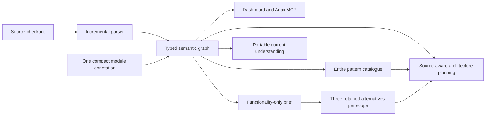

<p align="center">
  
</p>

<h1 align="center">AnaxiGraph</h1>

<p align="center">
  <strong>Understand the system. Guide the agent. Keep the architecture coherent.</strong><br />
  Shared architecture intelligence for people and AI coding agents.
</p>

<p align="center">
  <a href="https://github.com/hcekne/anaxigraph/actions/workflows/ci.yml"></a>
  <a href="LICENSE"></a>
  
  
</p>

<p align="center">
  <a href="docs/onboarding.md">Get started</a> ·
  <a href="docs/releases/0.9.0.md">0.9.0 upgrade notes</a> ·
  <a href="docs/agent-plugin.md">Agent plugin</a> ·
  <a href="docs/docker.md">Docker</a> ·
  <a href="docs/advanced-operations.md">Advanced</a> ·
  <a href="docs/brand.md">Brand</a> ·
  <a href="CONTRIBUTING.md">Contribute</a>
</p>

AI makes it easy to add code faster than a team can understand the architecture absorbing it.
Hidden coupling, duplicated responsibilities, inconsistent abstractions, and one-off agent changes
quietly become spaghetti code.

AnaxiGraph builds a semantic graph of your repository: modules, functions, interfaces, contracts,
capabilities and typed connections, with concise explanations attached to those entities. Read a
module's overview sentence first, expand its short paragraph and function summaries, then follow
callers, obligations and relevant tests. People explore the graph in the dashboard; coding agents
query the same saved understanding through AnaxiMCP without reopening every source file.

Source parsing makes the structural graph available immediately. Mapping adds one compact annotation
per changed module, replacing the previous pair of file essays. Evidence, source revision and model
provenance stay attached; source facts, inferred meaning and proposed designs remain distinguishable.

| Promise | For a person | For a coding agent |
|---|---|---|
| 🕸️ **Understand the system** | Move from product responsibilities and architecture areas to subsystems, files, named code parts, dependencies, and history. | Reuse a current repository-wide memory instead of rediscovering the architecture in every session. |
| 🧭 **Guide the agent** | See where a change belongs, what already exists, which patterns may fit, and what could be affected. | Receive a bounded working set, extension points, constraints, relevant tests, evidence, and counter-evidence. |
| 🧹 **Keep the architecture coherent** | Catch growing modules, repeated responsibilities, boundary erosion, cycles, and possible dead code before they harden into the design. | Rescan and compare the same goal after a change instead of treating passing tests as proof of good architecture. |

AnaxiGraph does not hand out a magic architecture score and does not edit the analyzed repository.
It keeps facts read from code, AI-created interpretations, and recommendations distinct so that
beginners can read a plain-language conclusion and experts can inspect the evidence behind it.

Give the agent your outcome, examples, boundaries and design preferences, then inspect and refine
the result together. The [directed development loop](docs/working-with-agents.md) shows how to
find ownership, check dependencies and tests, and compare each edit against an explicit baseline.

## 🚀 Start in four steps

You need Git, Python 3.11+, and [`uv`](https://docs.astral.sh/uv/).
**Recommended for agent integration: run AnaxiGraph on the host with uv**, under the same account
as your authenticated Codex or Claude Code CLI. Dashboard workers can then use those logins and
available models directly. AnaxiGraph needs **no model key** in `agent` mode; the chosen workers
use your own agent account's model allowance. Model availability and limits depend on that account.

### 1. Start the host service in your repository

```bash
cd /path/to/your/repository
uvx anaxigraph up . --open --semantic agent --connect codex
```

Use `--connect claude` for Claude Code. Omit `--semantic agent --connect codex` when you only want
the code-only map. Install and authenticate the selected agent CLI before running AI steps.

`uvx` runs AnaxiGraph in an isolated tool environment without adding it to your repository's
dependencies. For regular use, install the command once with `uv tool install anaxigraph` and use
`anaxigraph up . --open --semantic agent --connect codex`. Update with
`uv tool upgrade anaxigraph`, then restart the service. To update the one-command setup, restart
with `uvx --refresh anaxigraph up . --open --semantic agent --connect codex`.

This command creates or loads repository policy, stores AnaxiIndex outside the target, completes
the current scan, starts the loopback dashboard and AnaxiMCP. Historical mapping is opt-in with
`--history-snapshots auto` or an explicit count. Stop it with Ctrl-C; restart with the same command.

### 2. Build understanding through Workflows

Visit <http://127.0.0.1:8765>. Current architecture is ready before background history finishes.

The dashboard opens on **Workflows**. The diagrams are the control surface for building and
reviewing the map: select a step, configure its models and workers, run it, and open its results.

| Workflow | What you get |
|---|---|
| **Mapping** | Typed code graph, compact module/function annotations, linked caller contracts, a reviewed responsibility map and the Living Architecture Charter. Start here. |
| **Pattern analysis** | Every loaded catalogue card assessed and independently reviewed, with contextual ratings, pros, cons and useful placements. The bundled catalogue has 133 cards. |
| **Fresh eyes** | A functionality-only hierarchy and three retained alternatives per reviewed product, capability and subsystem scope. Blind comparison reports real differences, convergence and unknowns. |
| **Architecture planning** | Compare options, let the agent select a target, visualize current versus proposed boundaries and follow migration milestones. Your direction is optional. |

Use **Configure → Try 2 jobs** for a small sample, **Run this step** for one stage, or **Run full mapping**, **Run full pattern analysis**, **Run full fresh eyes** or
**Run full architecture planning** for the selected sequence. Choose provider, model, effort and worker count per step; settings show
what will run next separately from the recorded models that produced saved results. Saving settings
alone makes no model calls. Optional analysis stays **Not run** until requested.

Progress shows saved coverage, reused results, active workers, elapsed time and reported token
usage. Mapping step 5 reviews independent batches in parallel within each ordered OpenAI/Claude
pass, saves each batch immediately, then shows **Final reconciliation**. Resume retains successful
batches and retries failed work. The worker queue refills available slots as jobs finish.

The header identifies the checkout, branch, indexed commit and current commit. Structural scans,
AI mapping, Patterns and Fresh Eyes have separate freshness indicators. Current views load while
history builds. File lists sort/filter globally before paging; choose core columns or optional metrics,
then expand only the explanations you need. Graph evidence filters distinguish extracted, inferred
and unresolved connections; proposed/functional subjects use their own evidence states.
See the [workflow controls](docs/onboarding.md#explore-and-run-repository-workflows) for details,
or install the [persistent uv service](docs/advanced-operations.md#persistent-host-dashboard-with-uv)
to keep the host dashboard running between sessions.

### 3. Restart Codex in the repository

The explicit `--connect codex` option configures `http://127.0.0.1:8765/mcp` on the machine where
Codex runs. Restart it after first-time setup:

```bash
cd /path/to/your/repository
codex
```

### 4. Direct the agent with the shared map

Once Mapping is ready, give the agent an outcome, examples, design preferences and boundaries:

> Use AnaxiGraph to show me where this behavior lives, what depends on it, and which tests matter.
> Extend the existing owner, preserve its public contract, and compare the result with the
> pre-edit snapshot. Here is the behavior I want: …

**Guide** can copy a prompt with your goal, exact checkout and comparison baseline. The agent uses
the same map as the dashboard to inspect ownership, reuse existing code and check the change.
File, search, guidance and impact replies use compact defaults with an 8 KB budget; request `details=true` or CLI `--details`
when more evidence is needed. Documentation and benchmark data remain identifiable as supporting
artifacts rather than implementation starting points.

Use `ANAXIGRAPH_GRAPH` to page overview sentences or expand an entity's typed neighborhood, and
`ANAXIGRAPH_ENTITY` for its saved detail, function summaries and full obligations. Keep the returned
entity ID and repository/revision context. In **Understand → Graph**, choose observed code, the
functional brief, a Fresh Eyes alternative or a planning target independently from entity detail
and responsibility/path grouping. Proposed designs do not acquire source paths or LOC metrics.

You can also ask the agent to start or resume Mapping instead of using the dashboard:

> Use AnaxiGraph to build or resume the AI-created code map for this repository. Choose an
> explicit economical worker model, start or reuse the background run, and return its run ID.
> Let the worker manage the queue. Check compact progress when I ask; do not supervise it in an
> LLM loop or edit source while mapping.

For CLI examples below, install the command with `uv tool install anaxigraph`, or prefix each
command with `uvx`. The durable command survives the invoking Codex session:

```bash
anaxigraph understand . --executor codex --model '<worker-model>' --parallel-jobs 4 --background --json
anaxigraph semantic-status . --compact --json
```

Replace `<worker-model>` with your chosen Codex model. For Claude Haiku workers, use
`--executor claude --model haiku`. The repository's `max_parallel_jobs` setting limits total
concurrency across executors. Start small and increase workers within your account's limits.

`--background` keeps the worker alive after the invoking agent session exits. Return the run
handle and read compact status on request; ordinary software manages scheduling, leases and retries.
Choose a model explicitly to control cost. Provider limits and the repository's shared worker cap
still apply. Direct MCP work is a fallback when an authenticated host worker is unavailable.

The worker verifies the exact checkout before using a matching service's index. Linked worktrees
remain distinct; sharing a Git remote is insufficient. The completed map includes a reviewed
responsibility hierarchy and Living Architecture Charter, with evidence, provenance and unknowns.
Unchanged inputs reuse saved understanding. Upgraded legacy descriptions retain their original
provenance; missing function explanations remain structural until you deliberately enrich them with
Mapping. See [advanced operation](docs/advanced-operations.md) for executor choices, index authority,
Charter corrections and cost details.

The complete [onboarding guide](docs/onboarding.md) explains the normal coding loop and setup
diagnostics.

The installed AnaxiGraph skill carries the normal coding loop. The dashboard's `/api/glossary`
response exposes the same finding-state and measurement meanings for clients that render the
human interface; they are not duplicated as another agent tool.

## 🔁 Use one coding loop

**Architecture planning** can choose a direction for you. Leave its direction blank to use suggested
defaults, or add your goals and constraints. The agent compares preserving the current design with
incremental evolution and other justified options, selects a target, and records its reasoning.
You can choose another option later. The workflow shows current and proposed diagrams, Mermaid
exports, and ordered milestones with owners, contracts, verification and rollback. A selected plan
survives code changes; verification reports identify the scan they checked.

Read its summary with `anaxigraph plan .`; add `--details` for full options, diagrams and milestones.
Request it with `anaxigraph plan . --start`, or
`ANAXIGRAPH_GUIDE(intent="plan", start=true)`. Planning uses the existing background worker queue.
Ordinary coding guidance includes the saved target and next milestone.

Keep one persistent AnaxiGraph service running throughout the coding session. The service supervises
its structural watcher internally, so ordinary saves update cheap structural facts without a second
container or another model-backed repository pass. Build the complete AI map once when needed.

Give the connected agent one concrete goal. `ANAXIGRAPH_GUIDE` is the front door: use
`intent="understand"` for the system map, `build` for placement, `improve` for a bounded structural
change, `redesign` for the capability-first fresh-eyes review, and `reassess` after editing.

> Use AnaxiGraph to guide “add saved prompt exports.” Find the smallest relevant file set, tell me
> where the code belongs, inspect what depends on shared files, identify the focused checks, and
> refresh the shared map after implementation.

The agent follows one sequence:

1. **Guide** — `ANAXIGRAPH_GUIDE(intent="build"|"improve")` returns one evidence-backed
   recommendation, likely files, placement, counter-reasons, bounded impact, tests, and risks.
   Retain its `snapshot_id` as the pre-edit baseline.
2. **Impact** — `ANAXIGRAPH_IMPACT` shows direct dependants of the shared files before they change.
3. **Change** — edit source and run focused tests through the normal coding workflow. AnaxiGraph
   observes the repository; it does not edit it.
4. **Refresh and reassess** — request `ANAXIGRAPH_SCAN(refresh_semantics=true)`, finish any prepared
   AI work, then call `ANAXIGRAPH_GUIDE(intent="reassess")` with `from_snapshot_id` set to that
   baseline. Keep the same baseline across implementation phases until you deliberately choose
   another; the dashboard's **Changes → Compare from** provides the same control. The scan compares code fingerprints,
   reuses unchanged file meanings, and prepares only structurally changed files plus context whose
   interfaces or relationships changed. The shared before/after response explains observed changes,
   architectural consequences, possible improvements or regressions, reasons to leave the design
   alone, and the smallest safe verification step. It creates no approval or change-management
   state. The same result is visible under **Changes** or from `anaxigraph reassess .`.
   Use History when you need the wider introduction, recurrence, churn, or co-change context.

With the default `semantic.refresh: on_scan`, an explicit scan prepares those changed and affected
scopes automatically. `anaxigraph update . --prepare-semantics` is the explicit equivalent for a
repository that keeps manual refresh. Run `anaxigraph understand . --executor codex --background`
to execute the prepared work. Static reassessment is available immediately; ask again after
`semantically_ready` when the decision needs refreshed responsibility, duplication, pattern, or
possible-unused-code evidence.

The reviewed responsibility map has its own incremental validation boundary. It is carried forward
when the included file inventory and map policy still match and the fraction of unchanged
module roles meets `semantic.taxonomy.stability_bias` (default `0.8`). New or removed files, changed
map constraints, or broader responsibility drift trigger a fresh proposal and its configured agent
reviews. A carried responsibility map does not suppress changed annotations, group summaries, the Charter
or explicitly requested Pattern work.
Planning responses expose this decision and the currently queued cascade under `work_plan`.

Each guidance and impact reply includes server time, payload size, and model-token use. Semantic
status groups AI jobs by action with current-snapshot and lifetime time/token totals, while scan
results and detached execution records show wall-clock duration. Successful and failed attempts
contribute token totals when the executor reports them. A process killed before it emits usage is
still labeled unreported; zero is never presented as proof that the model call was free.

A changed metric or finding is not automatically an improvement. Expected behavior, focused tests,
and architecture evidence must agree. The [onboarding guide](docs/onboarding.md#use-one-coding-loop)
explains the same loop; lower-level and operator workflows stay in the
[advanced guide](docs/advanced-operations.md).

## 👀 Challenge the design with Fresh Eyes

Fresh Eyes asks how to deliver the required functionality without seeing the existing code or
implementation layout. It first prepares a hierarchy of **product purpose → capabilities →
functional subsystems**, then retains **three alternatives per reviewed scope**. Five alternatives
are an optional broader exploration setting.

```bash
anaxigraph fresh-eyes . --start --proposals 3
anaxigraph understand . --executor codex --model '<worker-model>' --background
anaxigraph fresh-eyes . --scope '<returned-scope-id>'
```

Every hierarchy, proposal, comparison and final review pass uses a fresh, tool-free worker with a
functional packet: purpose, required inputs/outputs, constraints and parent alternatives. It receives
no raw source, current topology, file names or Pattern verdicts. Oversized blind packets fail with a
scope/context-budget remedy; they are never spilled into tool-readable evidence pages.

Comparisons examine decomposition, control flow, state ownership, failure isolation and functional
fit. Three saved slots do not prove three different architectures: results explicitly report
convergence, limitations and unexplored directions. **Novelty remains unverified.** Alternatives,
pros/cons, parent compatibility and original provenance remain available; comparison does not
collapse them into one reference design.

The dashboard shows this under **Improve → Fresh Eyes** and the shared **Workflows** workspace.
Agents use `ANAXIGRAPH_GUIDE(intent="redesign", start=true, proposal_count=3)`; request `scope_id`
and `details=true` for full designs below product level. **Architecture Planning** subsequently
compares the alternatives with observed code and Pattern evidence, accepts optional direction,
and lets the agent choose a default target and migration milestones.

You can pin proposal slots to executor families, for example
`--proposal-executors codex,claude,codex`, and run a background worker for each family. Pins route
jobs; they do not establish independence or agreement. Saved provenance reports actual executors
and isolation. An external worker without enforceable isolation remains unverified.

Use `--restart` for a deliberate new review generation; ordinary code changes reuse an unchanged
functional brief. Read earlier generations with `--generation <n>`. Historical comparisons retain
original records side by side, without generating a new agreement score. Earlier v1 reviews remain
read-only archives, including their original conclusions and provenance.

## Carry the architecture with Git

Explicit workflows save reusable current understanding in a tracked root **`anaxigraph/`** folder
when writable. **Record v4** uses a versioned manifest, stable checksummed partitions and readable
JSONL for new annotations, contracts, catalogue assessments, functional alternatives and plans.
Original legacy results remain losslessly compressed with provenance. Existing record versions
can be imported; new writes use v4. Markdown and Mermaid keep the selected plan readable in Git.

Each coding host maintains its own service and rebuildable local index. After Git pull, AnaxiGraph
validates source fingerprints before reusing shared analyses; different clone paths are supported.
Parser IR, dependency caches, credentials, live queues and leases stay local. Export applies current
exclusions, including runtime data left by older scans. Git preserves earlier records; portable
storage is not a dump of historical SQL rows.

The default policy shares **100,000,000 bytes of steady retained state**, with ceilings of **25,000,000 bytes /
32 files for the portable record** and **95,000,000 bytes for the local index**. Those ceilings compete
for the shared pool; they are not separate reserved allocations. The index, shared memory and
portable copy share that retained budget. WAL, journals, SQLite temporary files and staged copies
also count toward the **200,000,000-byte transient physical ceiling**. The legacy archive is included
in the index count, not added twice. Recovery backups
and known migration peak are reported separately. Budgets are limits, not a claim that every legacy
repository already fits: saved work is preserved and an unmet budget is reported.

The [measured 2,598-file repository](benchmarks/results/semantic-graph-storage-2026-10-23.json) used
**98,700,489 bytes** for a fresh default-policy index plus portable record, with all 5,872 saved
documents reused without model calls. Its edited map and saved baseline also fit the default pool.
Upgrading the existing index used **103,648,457 bytes** under its original user-configured 200 MB
policy; preserving that history does not imply every legacy index fits the 100 MB default.

Current source plus two comparison checkpoints is the default retention policy; detailed history
is opt-in. Normal scans keep per-path Git aggregates; counts and dates identify their observed
window. Explicit history retains loaded commit rows. Exports check limits before publishing,
retain the last valid record on failure and clean
failed staging output. Unchanged saves write no new partitions. For a bloated existing index, run
`anaxigraph record compact . --db /path/to/anaxi-index.db --json` on its owning server: the backed-up
migration preserves original saved analyses while rebuilding disposable indexes.

For Flowthink or another scheduler, run on a checkout with authenticated agent CLIs:

```bash
uvx anaxigraph refresh . --workflows mapping,patterns,fresh-eyes,architecture --executor codex --model '<worker-model>' --json
```

The command saves partial progress and returns a nonzero status for unfinished work or export
failure. Configure Mapping nightly and optional reviews at their own cadence. Commit/push the
changed `anaxigraph/` files through the scheduler's normal Git process, then pull them on your coding
host. **Mapped locally**, **record exported**, **Git committed** and **Git pushed** are separate
states; exporting alone does not publish anything. See [repository records and scheduled runs](docs/advanced-operations.md#repository-records-and-scheduled-runs)
for migration, limits and scheduling.

## 🐳 Durable Docker sidecar

If you prefer an isolated, persistent container beside the repository:

```bash
cd /path/to/your/repository
uvx anaxigraph init . --start --semantic agent --connect codex
```

The generated Compose service mounts source read-only, drops Linux capabilities, enables
no-new-privileges, persists AnaxiIndex in a named volume, and publishes only to loopback by
default. Use `--connect claude` for Claude Code. Preview the full repository and client change with
`--dry-run --json`.

See [Docker operation](docs/docker.md) for manual Compose review, updates, watchers, and the
experimental multi-repository registry.

To move an existing Docker installation to uv, first preserve a consistent backup of its named-volume
index and workflow settings, stop the old service without deleting that volume, and restore/use the
host-visible index before starting uv. This retains paid results and avoids two services competing
for the same port. Follow the [Docker-to-uv migration](docs/advanced-operations.md#persistent-host-dashboard-with-uv)
for the actual index paths and recovery commands.

The image does not bundle Codex or Claude CLIs or their credentials. Dashboard model execution
needs those CLIs inside the service's environment; an installation on the host is not available
inside the container. Host execution with uv is the recommended route for direct dashboard worker
integration. Docker can still serve the shared map to connected agents and host workers.

## 🔌 Install the guided agent workflow

The shared plugin teaches Codex and Claude Code how to select the right indexed repository, build
or resume the AI-created code map, find a small set of likely files and affected callers, hand off
a planned finding, and verify a completed change.

Codex:

```bash
codex plugin marketplace add hcekne/anaxigraph && \
  codex plugin add anaxigraph@anaxigraph
```

Invoke `$anaxigraph`. Claude Code:

```bash
claude plugin marketplace add hcekne/anaxigraph && \
  claude plugin install anaxigraph@anaxigraph --scope user
```

Invoke `/anaxigraph:anaxigraph`. The plugin includes the default loopback MCP connection, so
plugin users may omit `--connect` from the start command. See the
[agent plugin guide](docs/agent-plugin.md) for the safety contract and custom endpoint behavior.

## How it works



Canonical annotation payloads are referenced by graph entities instead of copied into lookup
rows. ID/adjacency indexes and contentless full-text search make those references fast to query.
The local SQLite index stores code facts and bounded caches; the portable record carries the
understanding worth sharing. A graph shape or completed review is not a measured quality score.

Structural refresh and semantic execution are separate operations. A dashboard **Refresh scan**
runs asynchronously with observable progress and safe cancellation; semantic prepare/resume uses
the already-current snapshot and never hides a structural rescan inside the command.

Three named surfaces share one index:

- **AnaxiGraph** is the scanner, dashboard, and overall project.
- **AnaxiIndex** is the SQLite record of repositories, files, named code parts, direct code links,
  findings, history, and AI-created descriptions.
- **AnaxiMCP** gives coding agents size-limited repository evidence and controlled ways to update
  the external index.

AnaxiGraph does not execute target code or edit application source. A generated sidecar mounts
the target read-only. The local index serves fast queries; the tracked `anaxigraph/` record carries
reusable analysis and plans between checkouts. Explicit workflows save that record when writable.
Read-only services can load it, and report when they cannot publish updated files.

### Facts are not opinions

AnaxiGraph deliberately separates:

1. **facts read directly from repository data**—hashes, code structure, named code parts, direct
   links, Git changes, branch counts, imported test coverage, and which analyzer produced them;
2. **AI explanations**—purpose, responsibilities, role in the repository, related behavior, and
   pattern opportunities, each with the model, instructions, evidence, and evidence-strength
   rating that produced it; and
3. **recommendations**—reviewable proposals with evidence, counter-evidence, cost, safety, and
   lifecycle state.

Relationship edges say whether they are resolved, ambiguous, unresolved, or external. Dynamic
runtime wiring can still be invisible, so a missing edge is never presented as proof of dead code.

### One index, several views

The map selector distinguishes four sources instead of blending them: **Current view** uses
optional declared intent first, then the AI-reviewed **Responsibility map**, then the deterministic
**Path map** fallback; **Declared map** shows repository policy alone. Stable group identities are
kept separate from their display labels, and history uses today's current-view frame by default so
the same regions visibly fill and connect over time.

- **Understand** combines the Living Architecture Charter, overview, file inventory, and graph.
- **Guide** answers where to build and how to refactor with the same recommendation for a person or
  coding agent.
- **Improve** combines the ranked finding record and reviewed pattern intelligence.
- **Changes** compares the pinned baseline with current evidence; Git import/replay is optional advanced history.
- **Settings** owns repositories, readiness, refresh, and progressively disclosed operations.
- **Pattern intelligence** exposes complete coverage and paged ratings through `/api/patterns/catalogue`,
  with full saved evidence through `anaxigraph patterns` and `/api/patterns`. Guidance includes relevant recommendations directly for coding
  agents. Each result leads with a conclusion, evidence, action, cautions, and
  verification; its nine exact ratings are grouped and explained instead of shown as a number wall.
  Candidate results likewise explain why a pair was selected or skipped, what evidence is missing,
  and why the internal selection order is not itself a pattern recommendation.

`anaxigraph search "goal or code name" .` uses the same bounded SQLite FTS ranking as dashboard
search, `ANAXIGRAPH_SEARCH`, and the first step of architecture guidance. It searches paths, filenames,
symbols, summaries, responsibilities, contracts, and normalized aliases, then reports the semantic
provenance that contributed to each result.

## 🎯 Findings are a workflow, not a wall

The default attention list shows at most 20 useful findings and excludes routine long-function
notes. The complete record remains filterable and paginated; no evidence is deleted merely to
quiet the UI.

Every finding says what AnaxiGraph saw, why it may matter, what to do, when the code may be fine as
it is, and how to check the result. The dashboard, REST API, MCP tools, guidance results, and copied
agent prompt use the same wording. Exact rule IDs, evidence values, and ordering scores remain
structured fields for automation, but each field has an adjacent ordinary-language meaning; they
are never dumped into a jargon-filled “technical details” section. **Plan agent work** selects
a finding for implementation; its handoff also says which retained code map first shows the
problem, where it disappears, and whether it later returns. Resolution and regression normally
come from a later scan. Retained maps are samples, so the named frame bounds the change rather than
claiming that every Git commit was analyzed.

## Current support boundary

Python uses its built-in AST. JavaScript, JSX, TypeScript, and TSX use pinned Tree-sitter grammars
for structural symbols, imports and re-exports, CommonJS, modern dynamic imports, source spans,
TypeScript declarations, and syntax-level type evidence. Workspace targets resolve from indexed
`package.json`, `tsconfig.json`, and `jsconfig.json` evidence with explicit provenance and honest
ambiguity; AnaxiGraph does not run the target build or pretend it has compiler/type-checker or
runtime certainty. Other recognized source and text formats have heuristic or inventory support.
The roadmap deliberately does not call extension recognition “full language support.” See the
[capability matrix](docs/language-support.md).

Linux x86-64 is release-gated. Linux ARM64, macOS, and WSL2 are best effort; Docker Desktop is the
recommended macOS path. Native Windows is not supported—use WSL2. See the
[platform matrix](docs/platform-support.md).

The REST and MCP service is a local sidecar. Keep it bound to loopback or access it through a
trusted SSH tunnel; do not expose the port to an untrusted network.

## Advanced operation

The [advanced guide](docs/advanced-operations.md) covers local Codex/Claude/custom executors,
semantic cost and privacy, SSH forwarding, custom ports/state,
optional coverage imports, durable history controls, watchers, integrity diagnostics, upgrades,
resets, lower-level CLI commands, and several repositories.

## 🛠️ Development

```bash
uv sync --extra dev
uv run pre-commit install --install-hooks
uv run python scripts/run_quality_gate.py --base origin/main
```

The quality gate includes a fresh, repeatable AnaxiGraph scan of this repository. Its full report
is retained in CI and compared with
[`quality/self-analysis-baseline.json`](quality/self-analysis-baseline.json); new or worsened
warning/error findings fail while unchanged information-level diagnostics remain visible and
non-blocking. Run it directly with
`uv run python scripts/check_self_analysis.py --output /tmp/anaxigraph-self-analysis.json`.

The product brief is [`repo_instructions.md`](repo_instructions.md), the consecutive roadmap is
[`docs/feature-development-plan.md`](docs/feature-development-plan.md), and the release contract is
[`docs/releasing.md`](docs/releasing.md). Contributions are welcome; see
[`CONTRIBUTING.md`](CONTRIBUTING.md).
