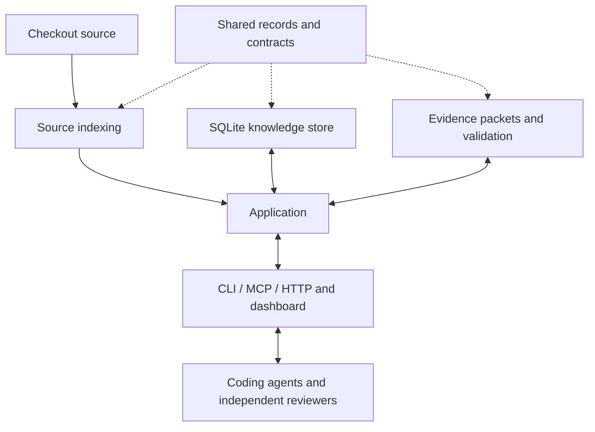

# AnaxiGraph V2 architecture

Help people and coding agents write better code, make sound architecture decisions, and leave the
next change straightforward.

## Selected direction — 25 October 2026

The maintainer selected a clean replacement, starting in `anaxigraph-v2/`. This supersedes the
24 October recommendation to freeze all existing capabilities before comparing implementation
routes. Existing features are candidates, not mandatory migration obligations. Build the useful
minimum first and add features selectively. Fresh Eyes and pattern discovery remain core ideas.

The existing 0.9.1 implementation remains available separately. V2 imports none of its runtime.
The only copied product data is a compact selection of the existing 133 pattern cards; their old
scoring, planning and execution engines were not copied. The Apache license is retained. The
dashboard borrows visual direction, with a new small implementation.

## Six components, one application

| Component | Provides | Must not own |
| --- | --- | --- |
| `contracts.py` | Immutable snapshot, node, edge and graph records; storage protocol | SQL, frameworks, source parsing or workflows |
| `indexing/` | `index(root) -> Graph`, `capture_snapshot` and `capture_sources`: exact identity, bounded verified source, Python syntax and scoped references | Executing analyzed code, generating semantic prose or saving results |
| `storage/` | Atomic graph publication, canonical annotations, compact FTS and bounded reviews | Architectural judgment, source parsing or provider execution |
| `analysis/` | Source/behavior evidence packets, complete-result validation and bounded guidance | SQL, UI, model-provider state or reading project files |
| `application.py` | Compose operations, guard source/context identity, publish validated results | A separate store, parser, provider engine or transport-specific reasoning |
| `interfaces/` | CLI, ten MCP tools, HTTP and dashboard over the same application | Independent ownership inference or analysis state |

These are logical Python packages with explicit records and functions, installed together. Separate
distributions, services and plugin systems would add deployment work without helping this milestone.
The boundary tests make their dependency direction executable. Interfaces can evolve behind these
contracts without forcing their callers to know internal implementations.

## First milestone

1. Scan a checkout into a useful structural graph without a model call.
2. Inspect modules/functions, dependencies, consumers and observed test links.
3. Prepare a change using lexical/symbol/capability evidence; assess proposed file placement.
4. Compare current and previous scans; attribute supplied check reports to the exact candidate.
5. Generate an annotation task with every supplied function and accept only complete results.
6. Generate a pattern task accounting for every catalogue card for the selected modules, including
   ratings, pros, cons, simpler alternatives and unknown evidence.
7. Generate a behavior-only Fresh Eyes task retaining three independently described alternatives,
   complete declared requirement coverage, tradeoffs and high-level Mermaid diagrams.
8. Explore the same saved understanding through a sortable table, focused graph and review workflow.

External coding agents do the model reasoning in this milestone. There is no hidden simulated
analysis or automatic model scheduler. Each request is saved before work starts. Results validate
against its snapshot, declared scope, coverage, size and evidence references. Stale source or
changed annotation inputs are rejected; completed annotation retries are idempotent. Annotation
batches commit each module individually so an interrupted submission can safely retry.

Annotation validity includes its own source and resolved outgoing source dependencies. A dependency
change conservatively marks an unchanged caller's explanation stale. This is not a guarantee of
complete dynamic-call invalidation. Stored annotations distinguish agent interpretations from
source observations; contracts distinguish declared evidence from inference. Reviews remain proposals.

## Fresh Eyes isolation

The returned blind request contains opaque requirement IDs, behavior statements and the response
contract. Source, module identities, symbols, dependency topology and prior recommendations are
excluded. Literal mapped-source identities in behavior statements are rejected. Functional statements
still require judgment: the validator cannot prove a sentence contains no conceptual implementation
assumption, that all product requirements were extracted, or that three descriptions are genuinely
different architectures.

Give only this packet to a fresh worker without repository/source tools. The server controls packet
contents; it cannot sandbox an external coding agent's filesystem. Source-aware assessment of a
frozen alternative must remain a separate operation. This milestone preserves alternatives rather
than declaring one tested or best. Product/subsystem hierarchy and rigorous scenario comparison can
be added to this component when useful, without giving blind designers source access.

## State and bounds

- One local SQLite database per checkout by default: `.anaxigraph-v2/knowledge.sqlite`.
- Root identity is the exact resolved checkout. Linked worktrees do not share mutable analysis.
- Content, revision and analysis identity pin snapshots, including eligible untracked source.
- Current graph plus one previous comparison graph; repeated unchanged scans do not append history.
- One canonical module annotation contains its sentence, paragraph, function sentences and contracts.
  Search indexes compact names/overviews; it does not copy full essays or source bodies.
- Canonical node and interned-edge sets are compressed inside SQLite. Small source indexes support
  annotations/search. The application keeps at most one materialized current graph in memory;
  a database change from any process invalidates it. No decompressed graph is written alongside it.
- The default database ceiling is 100 MB. Writes fail atomically and preserve the last valid map.
  SQLite rollback journals are temporary; retained data is not an unbounded history archive.
- Up to 64 recent request packets and 20 completed reviews per checkout, tied to the two retained
  snapshots. This alpha is a current-understanding workspace, not long-term saved-analysis archival.
- Ordinary lists are compact and paged. Source packets and explicit review/entity expansion are
  separate from list views; task/result size ceilings remain enforced.

## Deliberate limits and next choices

Python/PYI is supported first. JavaScript/TypeScript are fingerprinted and explicitly unparsed.
Static resolution is incomplete for dynamic dispatch and frameworks; missing edges do not prove
dead code. No project code or project tests are executed by the service. Check results are
fingerprint-attributed agent/CI reports, not independently attested executions.

Git-portable records, old-result import, shared worktree bases, autonomous worker pools, accepted
architecture-rule editing, hierarchical design comparison and production deployment are not part
of this first milestone. Existing saved analyses and the legacy database remain untouched. Reuse
or add any of these only after a concrete user need justifies it; the old feature list is not frozen.

## Packaging destination

Keep the existing PyPI project name `anaxigraph`. Develop V2 here as `1.0.0a1` in its own uv
environment. The root project remains 0.9.1 and the existing release workflow remains attached to
it. No V2 release or production replacement happens merely by adding this folder.

When the selected product is ready, move the qualified V2 package to the release root, update its
README/metadata/plugin commands, qualify migration and installed-package behavior, and publish
`anaxigraph==1.0.0` through the existing trusted publisher. Earlier package versions need not be
removed. Optional public prereleases can precede that transition. See the
[Python version specification](https://packaging.python.org/en/latest/specifications/version-specifiers/).

## Evidence before adding complexity

Record cold/warm scan time, read latency, current bytes, repeated-cycle growth and real agent task
outcomes. Keep fixture correctness, actual browser/MCP integration, installed-wheel checks and
live model review distinct. A passing shape validator does not demonstrate better architectural
judgment. Add later-change evaluation before claiming the tool improves maintainability.
