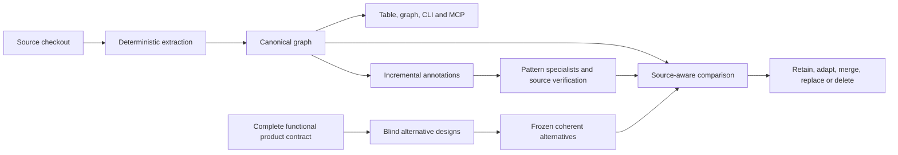

# AnaxiGraph 0.9.2 performance and architecture request

**Status:** Historical proposed scope. On 25 October the maintainer selected a clean V2 replacement
and selective MVP features instead of preserving every capability. The active direction is in
[V2 architecture](../../anaxigraph-v2/docs/architecture.md). The published package remains 0.9.1.

**Date:** 24 October 2026

**Implementation audited:** `986a1a744966a3859cbe48ab22da079f8dcbb637`; production code is
unchanged from 0.9.1. The completed self-review analyzed source commit `b903a02`.

AnaxiGraph should deliver a useful code graph in minutes, add concise understanding, examine
architectural opportunities systematically, and help remove unnecessary complexity. Version 0.9.2
should simplify the machinery serving those outcomes while repairing the defects exposed by the
first complete live self-review. More workers alone will not remove serial work or duplicated work.

The maintainer's direction is retained in [the feedback record](../feedback/2026-10-24-0.9.2-direction.md).
[Dead-code research and actual checks](../research/2026-10-24-dead-code-detection.md) support the
retirement work below. Earlier [backend](semantic-graph-redesign-2026-10-23.md) and
[frontend](semantic-graph-frontend-2026-10-23.md) requirements continue to apply.
A [change-loop review](../change-loop-review-2026-10.md) of an external proposal adds two freshness
repairs and an agent-outcome evaluation that should rank the retirement ledger.

The maintainer's [complete from-scratch proposal](../proposals/2026-10-24-from-scratch-proposal.md)
is also preserved. Its [comparison, bottom-up estimate and rewrite decision framework](0.9.2-rewrite-assessment-and-estimate.md)
strengthen this scope with a task/change loop and controlled usefulness evaluation. The smaller
Python-only milestone is a possible experiment, not a replacement for the full requirements here.
No replacement implementation or final rewrite decision has been made.

## What the completed audit establishes

| Stage or outcome | Actual result | Interpretation |
| --- | --- | --- |
| Initial structural scan | 52.165 seconds; 845 files; 9,105 structural relationships | Deterministic extraction is already approximately minute-scale. This timing excludes later graph/API preparation. |
| First 843 successful annotations | 13 minutes 52 seconds, with 16 Luna workers | Bulk annotation was substantially faster than the full workflow. |
| Two remaining annotations | Succeeded on Sol/high; approximately 70 and 100 seconds | Automatic escalation should precede expensive global derivation. |
| Taxonomy proposals | 52 minutes 49 seconds, then 55 minutes 5 seconds | Internal partitions were serial; global work was repeated after two annotations changed. |
| Taxonomy reviews and synthesis | 186 review jobs and 58 synthesis jobs across the run | Successful file annotations were preserved, but substantial derived work was regenerated. |
| Pattern assessments and reviews | 133 assessments and 133 independent reviews; 52 insufficient-evidence results | Complete catalogue coverage, not complete module-by-pattern coverage. |
| Fresh Eyes | 27 alternatives across nine scopes; nine comparisons and final review | Saved stages do not establish functional completeness or architectural usefulness. |
| Full elapsed time | Approximately 8 hours 15 minutes, including stops and recovery | This is unacceptable as the normal path to a useful map. |
| Stored results | 64,323,584-byte index plus 16,255,624-byte portable record; 32 record files | 80,579,208 retained bytes, within the existing 100 MB policy. |

The queue contains 1,395 completed jobs and 1,429 recorded attempts. Job rows report 51,788,416 input
tokens and 3,668,981 output tokens. These are recorded accounting totals, not a complete count of
provider requests or an invoice: some jobs hide several model calls inside one logical task.

The evidence is preserved in the [committed self-review record](https://github.com/hcekne/anaxigraph/tree/986a1a744966a3859cbe48ab22da079f8dcbb637/anaxigraph).
The operator's local verification and recovery audits are under the checkout's external state
directory, including `self-review-verification.json`, `self-review-findings.json`, and `recovery/`.

Primary implementation points are the [catalogue planner](../../src/anaxigraph/pattern_catalogue_plan.py),
[bounded Pattern witnesses](../../src/anaxigraph/semantic_pattern_requests.py),
[workflow execution](../../src/anaxigraph/workflow_execution.py),
[taxonomy proposal runner](../../src/anaxigraph/semantic_taxonomy_runner.py),
[existing durable review batches](../../src/anaxigraph/semantic_taxonomy_review_plan.py),
[functional projection](../../src/anaxigraph/semantic_fresh_eyes_functional.py),
[Fresh Eyes request assembly](../../src/anaxigraph/semantic_fresh_eyes_functional_requests.py), and
[functional schemas](../../src/anaxigraph/semantic_fresh_eyes_v2_contract.py).

## Interpret the recommendations before turning them into work

Several useful ideas emerged, but their evidential strength differs.

| Audit finding | Source check or limitation | 0.9.2 response |
| --- | --- | --- |
| Product alternatives drop required behavior | Product designers received zero of four required-capability statements. Global invariants and scenarios also lacked a lossless path through hierarchy generation. | Fix the product contract before choosing a target architecture. |
| Proposals disagree about writers, drafts, progress and recovery | The final Fresh Eyes review identifies competing owners and incompatible parent/child options within its proposed designs. | Assemble coherent alternatives; define one owner for each state transition and distinguish finished records from attempts. These are not automatically defects in current source. |
| Add architecture fitness checks | CI already enforces size, complexity, dependencies, self-analysis and coverage. | Reject a duplicate generic check framework; identify any actual missing property first. |
| Introduce provider contract tests | A shared provider protocol, adapter tests, strict-schema tests and failure/usage tests already exist. | Specify uncovered contracts, especially the live Fresh Eyes failures. Do not infer absence from omitted witnesses. |
| Improve time limits | Dashboard `request()` has no shared deadline; MCP retries each receive a new per-call timeout. | Investigate bounded quick reads and shared caller deadlines. Preserve explicit long-model-run policy; timeouts do not fix serial scheduling. |
| Improve state transitions and boundaries | Review candidates identify scan cancellation, accepted results, coverage SQL and provider boundaries. | Verify each proposed change against callers and existing tests before adding abstractions. |

An opportunity score is a model judgment. Unknown conformance must remain unknown; a packet that
omits tests cannot justify a low conformance score or a claim that no tests exist. Source-aware
verification must retrieve missing evidence and publish a concrete current-versus-proposed delta.

## Make the graph independently useful

The core product has four responsibilities:

1. Parse source into entities, interfaces and typed relationships.
2. Attach concise meaning and evaluate architectural questions.
3. Execute optional model work with bounded capacity, saved progress and recovery.
4. Store current understanding once and share compatible results between checkouts.

CLI, HTTP, MCP and the dashboard should be thin interfaces to that core. Retain the sortable module
table, function/interface traversal, graph inspection and illustrated workflows. A structural map
must be available while annotations, grouping or architectural reviews continue.

Source bytes must be read to extract imports and calls; that deterministic parsing is cheap.
It must not depend on an LLM reading every file. Display structural readiness, annotation coverage,
review coverage and unresolved evidence separately. Keep one overview sentence and short paragraph
per module, with a brief function description and linked contracts rather than repeated essays.

The functional contract is a separate projection. The observed graph and Pattern judgments must
not enter the blind design workers through this diagram's comparison stage.

## Connect the graph to making and checking changes

Expose one common application contract through CLI, HTTP, MCP and the dashboard:

| Action | Required result |
| --- | --- |
| Prepare a change | A compact revision-pinned brief naming likely ownership, reusable capabilities, required contracts, examples, affected areas and verification obligations. |
| Inspect | Progressive module, function, interface, contract, consumer and test evidence with honest freshness and resolution status. |
| Assess a plan | Evaluate a caller-supplied proposed edit for placement, reuse, unnecessary complexity and contract risks. Architecture-option generation alone does not implement this. |
| Validate a change | Compare exact base/candidate states, report architectural deltas and associate executable evidence with the candidate bytes and checked scope. |

Reuse existing GUIDE, IMPACT, GRAPH/ENTITY and reassessment behavior where it meets this contract.
Facts, inferences, accepted intent and proposals retain different statuses. Corrections survive
refresh as explicit overlays; source contradictions remain visible. Structural test associations,
model judgments and reported evidence do not count as executed behavioral verification.

Collect CI/agent check receipts with candidate identity, command, working directory, checked scope
and result origin; the service remains read-only and does not execute target-project code. Failed,
stale, unexecuted and inconclusive checks remain distinct. Reference resolution and test selection
disclose missing or dynamic coverage.
Keep ordinary edits lightweight and retain independent architecture exploration through the existing
workflows. This change contract does not replace blind Fresh Eyes or full catalogue consideration.

## Repair execution before adding more machinery

### Finish difficult annotations before global derivation

Start with economical models. Classify a failed result, return precise validation diagnostics,
and escalate only the affected work to Sol/high, Astra/high or a permitted stronger provider.
Keep successful annotations. Distinguish a quality failure from rate limiting, unavailable models,
storage failure and an inconsistent request contract; repeating an identical request is not recovery.

Do not produce an expensive final taxonomy and charter over missing annotations and then rebuild
them wholesale when those annotations arrive. Either complete escalation first, or define stable,
incremental scopes whose affected derivations can be updated independently. Partial graph inspection
remains available throughout. Restore economical defaults after exceptional retries.

### Parallelize durable taxonomy partitions

The current path confuses one final result with one model-call slot:
`WorkflowSettings` requires one taxonomy-proposal worker; `WorkflowExecution._run_pool` sets
`max_parallel_jobs` to that worker count; the proposal's `parallel_map` therefore gets capacity one.
Its independent proposal partitions are accumulated in memory instead of saved as separate jobs.

Reuse the existing durable review-batch mechanism for proposal partitions. Each partition needs
an input identity, independent checkpoint and retry state. Reconciliation combines completed
partitions into one proposal. Preserve the ordered Codex and Claude review passes and show the
final reconciliation explicitly. Reuse completed partitions after interruption.

Use one admission mechanism for actual model calls, including calls inside logical tasks.
Do not add another orchestration service or a second general-purpose scheduler. Progress must show
completed/total partitions, active calls, queue waits, retries, escalation, elapsed time and final
reconciliation. Provider-call accounting must not disappear inside a single long job.

### Support 50 to 100 active workers where resources permit

Support configurable 50- and 100-call profiles across configuration, saved choices, API and UI.
The current repository setting is 32; the saved-worker schema also caps a pool at 64. These limits
must agree with the selected profile. Apply provider-specific limits, shared capacity, backoff and
resource checks through the same admission mechanism.

Compare real 16/32/50/100 profiles. Measure useful completed work, provider throttling, tokens,
process startup, memory, writer contention and elapsed time. Cheap models still consume tokens and
provider capacity. A hundred workers is an available capacity, not a promise of linear speedup.

## Evaluate every module against every pattern

The current planner creates one repository-root assessment per catalogue card. It supplies up to
eight likely placements and eight bounded source witnesses. Its 133/133 count does not satisfy
the maintainer's new requirement to evaluate every module for each pattern.

Create a logical specialist for every catalogue pattern. Its instruction is to test the strongest
case for and against using that pattern across the entire declared module inventory, including
places already implementing it well. Owning a pattern must not mean recommending it everywhere.
Anti-pattern cards diagnose and propose remedies; they are never patterns to introduce.

For the current complete 845-file inventory and 133 cards, the illustrative full matrix contains
**112,385 pairs**. The inventory includes tests, documentation and data as well as production code.
Record role and scope explicitly: non-implementation artifacts can receive a wrong-scope decision
and supply evidence, rather than silently disappearing or being told to become a factory.

Each pair needs a recorded disposition, rating where meaningful, evidence sufficiency and concise
contextual reasons, pros and cons. Distinguish already suitable, improve existing use, introduce,
poor fit, wrong scope and insufficient evidence. Do not convert an unknown into a negative judgment.

Batch module pages within each specialist. For illustration, 64-module pages require 1,862
screening calls; 32-module pages require 3,591. These are sizing calculations, not chosen defaults
or measured timings. Prototype page sizes and evidence budgets before selecting the production
profile. A pair assessment is not a separate operating-system process or mandatory separate call.

Also inspect connected module families, interfaces, subsystems and the whole repository. Shared
contracts and useful abstractions often span several files and cannot be discovered by treating
each file as an isolated program. Broad review must cover many catalogue families rather than
anchoring on the maintainer's agent-provider example.

Independent stronger review must challenge the compact full matrix, including negative decisions,
and retrieve relevant source, callers and tests for uncertain or actionable proposals. Do not let
an initial shortlist become the only evidence the reviewer can see. Reuse canonical module cards
and graph facts; avoid repeating the whole repository in every prompt.

Store compact pair results with shared reason/pros/cons dictionaries and references. Expanded
explanation belongs with distinct useful or uncertain placements. Writing 112,385 independent
essays would defeat both the storage and reading goals. Preserve unchanged cells and invalidate
only changed modules/cards and necessary relationship context.

The UI must expose both catalogue coverage and module-pair coverage, with missing and unresolved
work visible. Support views by module, pattern and connected family; sortable ratings, contextual
pros/cons and links to the relevant graph. Keep bounded default MCP/API replies and explicit paging.

## Make Fresh Eyes reason from the whole function

### Preserve an immutable product contract

`functional_scope_packet` currently selects requirements only from a scope's own `capability_ids`.
The saved product scope has an empty list, so its designers saw zero of four capability statements.
Hierarchy output also fails to retain original global invariants and scenarios deterministically.
Simply unioning child requirements will not repair that second loss.

Freeze the product's purpose, required functions, observable scenarios, global invariants, budgets
and uncertainty before generating architectures. Hierarchy generation groups requirement IDs;
it cannot rewrite or discard that contract. Every product designer gets the whole contract.
Every lower scope gets global invariants and its deterministically computed requirement closure.
Every blind comparison and final reviewer also receives the complete original product contract,
so it can independently test functional coverage instead of trusting earlier summaries. The current
final-review packet supplies scope IDs and comparisons without that full contract.

Repair the functional protocol and input identities as a new review generation. Preserve the old
outputs as historical results with their coverage gaps. Do not reuse the lossy hierarchy merely
because its source projection is unchanged, or relabel old alternatives as repaired.

Separate externally required compatibility from today's implementation choices. Use the maintainer's
TV analogy: the required viewing experience belongs in the contract; today's display technology,
driver structure and component layout do not become mandatory merely because they exist.
Direction remains optional. Supply useful defaults and disclose assumptions when the user leaves it blank.

### Generate architectures before fixing their decomposition

Generate three whole-product alternatives independently from purpose and constraints, then let
each propose its own boundaries. Do not force every alternative through the same pre-generated
subsystem partition. Preserve three alternatives at useful functional scopes without expanding
every minor programming function into a new architecture exercise.

Keep consistent parent-design lineages and make compatibility explicit. The current final review
correctly warns that many child choices cannot be freely combined. A selected target must resolve
competing writers, progress ownership, partial-publication rules and recovery semantics.

Require a minimum-complexity challenge: demonstrate each required scenario; justify every persistent
state, cache, coordinator, interface and process; try removing or merging each responsibility.
Estimate custom code by responsibility, including work hidden behind an "analysis engine" box.
Fewer boxes do not establish fewer lines or a simpler implementation.

Freeze blind alternatives and critiques before any source-aware comparison. Preserve fresh contexts,
no source/repository access, no retrieval through source-bearing tools, and accurate isolation labels.
Removing filenames alone does not eliminate concepts inherited from today's Charter and taxonomy.

### Fix the two demonstrated prompt defects

Publish exact existing hierarchy-parent rules: product root, capability under product, subsystem
under capability. Publish exact graph rules: edge endpoints reference declared component keys,
with valid revision and parent-alternative references. Generate instructions and diagnostics from
the same contract definitions used by validation.

Return permitted parents, missing functions or invalid endpoint keys to bounded repair attempts.
Do not weaken validators. The current hierarchy failed across Sol/medium, Sol/high, Astra/high and
Opus/high before a clarification worked. Model escalation alone cannot repair an omitted rule.

## Use the existing alternatives critically

| Saved product alternative | Useful idea | Gap preventing direct adoption |
| --- | --- | --- |
| Direct action ownership | Keep fast actions and failures together; share access and records | Durable continuation was not supplied to its designer; crash-resume behavior is not established. |
| Stateless transformations and immutable records | One owner for results; checked publication; shared fingerprints | Partial work and failure preservation were omitted; indefinite accumulation conflicts with the storage goal. |
| Controller and bounded worker processes | One owner for progress and accepted output; attempt identities and failure isolation | Captured-input storage and controller complexity need justification; complete functionality was not demonstrated. |

Their tradeoffs are useful hypotheses. The root comparison's claim that functionality was covered
cannot stand against the missing input requirements. Eight other scopes showed partial convergence;
saved proposal count is not proof of novelty.

Source-aware Architecture Planning was not part of the three-workflow run. That explains why the
output contains alternatives and composition warnings rather than a selected code-level migration.
Make the next action clear in the workflow UI: explain findings, compare frozen alternatives with
the actual graph, and produce a plan. Recommend a justified default target while retaining user choice.

Planning should map required behavior to owners and classify current code as **retain, adapt,
merge, replace or delete**, with exact consumers, contracts and verification. Judge target merit
separately from migration cost. A plausible lean direction combines direct fast graph operations,
pure transformations over canonical facts, and one durable runner only for expensive work;
its mutable attempts and immutable completed results need distinct ownership. This is a design
to test against the complete contract, not an instruction to splice all three old proposals together.

## Reduce the actual codebase

The same production-source definition gives these baselines:

| Version | Production files | Physical production lines | Python | Frontend |
| --- | ---: | ---: | ---: | ---: |
| 0.7.2 | 308 | 64,949 | 58,192 | 6,757 |
| 0.8.5 | 366 | 73,885 | 65,358 | 8,527 |
| 0.9.1 | 423 | 79,060 | 71,391 | 7,669 |

Count `.py/.js/.jsx/.mjs/.cjs/.ts/.tsx/.css/.html` under `src/anaxigraph`, including physical
comments/blanks as the existing ratchet does. Tests are separate: 43,526 lines in 253 code files.
The 845 mapped files are not 845 production modules. Relative to 0.8.5, production grew 5,175 lines
and 57 files; backend growth exceeded frontend savings.

Treat approximately **39,530 production lines** as a 50% redesign target to prove, not a discovered
dead-code count. Build a retirement ledger before assigning cuts: responsibility, real entrypoints,
consumers, replacement, compatibility duty, proposed deletion/consolidation, expected reduction and
verification. If preserving required behavior makes that target infeasible, identify the specific
features and achievable alternatives rather than silently raising the budget or hiding code.

Audit the 92 `semantic_*` modules/18,367 lines and 74 persistence modules/15,077 lines first, alongside
CLI/background/workflow/remote-worker coordination. Consolidate duplicated planning, dispatch,
retry, state and projection paths. Keep thin interfaces instead of separate application models.
Merging all 111 sub-100-line Python files would mostly change navigation, not remove behavior.

The old two-essay producer really was retired; remaining labels/readers are not proof that it
still writes duplicate descriptions. Preserve paid analyses through a narrow validated import/read
boundary. Classify full-history ingestion and other optional live features as explicit product-scope
decisions, rather than calling them dead because they are expensive or old.

### Detect unused code without age gates

Remove age from primary candidate eligibility. Stable used code stays live; recently replaced
unreachable code can be flagged immediately. Dates may remain context, never evidence of use.

Build reachability from real CLI, API, MCP, worker, browser and declared public entrypoints down
to symbols. Recognize callbacks, decorators, registries, exports, resources and reflective use.
Track production references separately from tests. Report unreachable files, orphan helper closures,
test-only code, optional live features, compatibility surfaces and unresolved dynamic use separately.

Use static tools and coverage as evidence, then perform small reversible deletion experiments with
focused checks. Existing zero findings came from a rule requiring 90-day-old files; the saved
inventory contained no paths that old. It did not establish a clean codebase. The new independent
checks found concrete small candidates, not evidence that half the project is unreachable.

Measure removed concepts, state models and duplicate execution paths as well as lines/files.
No minification, moving equivalent work into generated/data files or another maintained package,
deleting required workflows,
or changing the counting definition to claim simplification. Lower source ratchets only after
actual reductions; retain ordinary quality limits and keep slow checks in CI.

## Delivery and acceptance

| Work | Evidence required before calling it delivered |
| --- | --- |
| Functional contract and prompt repair | Saved regression replay gives product designers, comparisons and final reviewers all four capability statements plus global invariants/scenarios. Scenario-to-alternative coverage is checked independently. Corrected protocol identities start a new generation; old results remain historical. Native providers finish representative cases without operator clarification; strict schemas and original validation remain effective. |
| Parallel taxonomy | Independent partitions overlap despite one final result; every completed partition survives interruption; reconciliation waits for dependencies and provider passes remain ordered. |
| Automatic escalation | Injected weak-model validation failure retries only failed work on a stronger permitted model; global work is not needlessly built twice; successful results and economical defaults survive. |
| Exhaustive Patterns | The declared 845-file/133-card fixture accounts for all 112,385 pairs. Missing/duplicate members fail validation. Strong review examines negatives and uncertain evidence. Known opportunities and healthy controls span multiple pattern families. |
| Useful Fresh Eyes | Two different legacy implementations of the same product produce the same blind functional contract. Every alternative explains all scenarios, justifies complexity, preserves consistent descendants and discloses convergence. |
| Actionable planning | Current/target diagrams, module/function retain/change/delete decisions, affected contracts and migration verification follow from frozen alternatives and checked source. |
| Real retirement | New orphan code is detected immediately; stable reachable code and framework callbacks remain live. Candidate closures, test-only use and compatibility duties have explicit evidence. |
| Smaller implementation | Publish actual before/after production lines, files, bytes and responsibility counts against 79,060/423; explain the result against the 39,530-line target. |
| Performance | Publish actual provider-call and stage timings at 16/32/50/100 capacity. Qualify structural graph availability separately from annotation and full reviews; include retries and reconciliation. |
| Storage | Keep the existing 100 MB shared retained default, 25 MB/32-file portable ceiling and 200 MB transient ceiling. The new matrix must fit through compact storage, not larger limits. |
| Change guidance | Demonstrate existing-capability reuse, appropriate ownership, preserved obligations and candidate-bound check results on representative tasks; disclose unresolved evidence. |
| Usefulness evaluation | Extend the existing task harness with ordinary-tools, structural and full-guidance arms; split semantic briefs from plan/patch feedback when they can be isolated. Use comparable tasks/revisions/models/budgets, include setup/refresh cost and whether agents use the advice, then give a fresh agent a subsequent change. |

Use the current run as the reference corpus. Initial performance targets for qualification are a
usable structural graph in about one minute, full module enrichment in minutes rather than hours,
and independently parallel global partitions. Set the final end-to-end review target after the
first measured specialist-batching prototype; do not advertise a duration inferred only from worker count.

Suggested delivery order: preserve and validate product requirements; fix failure/escalation and
partition scheduling; prototype exhaustive pattern screening and blind design quality; demonstrate
the lean replacement/deletion ledger; implement the core consolidation and source-aware planning;
then qualify the complete workflows and publication. Retain original saved analyses and provenance.

For the implementation-route decision, compare targeted consolidation and a clean replacement core
on the same representative contract. Require correct state identity, blind design isolation, full
declared coverage, paid-record migration, interruption recovery and storage stability before scoring
line count or speed. Measure maintained transitive code and state/execution owners, not just a new
facade. Select replacement when it demonstrates materially simpler execution and credible full-scope
delivery; retain consolidation when it achieves comparable results with less transition work. This
evaluation adds no slow pre-push check and does not authorize destructive removal of the current tool.

## Documentation and release content

README, PyPI, GitHub release copy, plugin descriptions, CLI help, onboarding and workflow text must
describe the implemented 0.9.2 system. `pyproject.toml` uses `README.md` as PyPI's long description;
review its short project description separately. Include the website's release/changelog text and
installation, upgrade and Docker-to-uv guidance.

The current README now records the measured 0.9.1 behavior and known audit limitations. Published
0.9.1 package metadata is immutable; the rebuilt 0.9.2 distribution must carry the revised README
and description when that implementation is ready.

After implementation and qualification, rewrite these around the actual graph, semantic enrichment,
module-pattern coverage, blind Fresh Eyes boundary and source-aware planning. Show current defaults,
worker profiles, automatic escalation, storage policy and independent progress/delivery states.
Run documented commands against the built package. Update screenshots and diagrams where behavior
changes. Preserve the distinction between measured structural speed and measured full-review speed,
and between novel hypotheses and validated architectural improvements.

Do not publish planned features as already available, retain obsolete two-essay instructions, or
describe catalogue coverage as module coverage. Keep version metadata consistent across package,
lockfile and both agent plugins when the actual release is prepared. The final GitHub/PyPI/container
release must have real installation and workflow evidence; this request does not itself publish 0.9.2.
