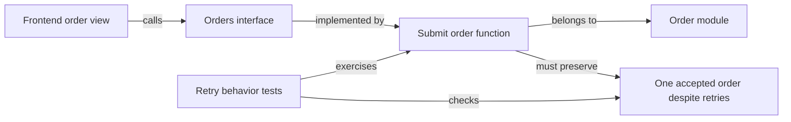

# Frontend design for the semantic graph

**Status:** Frontend evaluation and required plan changes. Product UI changes are not implemented.

**Parent design:** [Semantic graph architecture and product objectives](semantic-graph-redesign-2026-10-23.md).

The semantic graph changes how people explore and understand AnaxiGraph's results. Preserve the
sortable module table and workflow workspace, rebuild graph exploration around typed entities and
relationships, and share selection, concise descriptions and evidence across those views. This is
part of the architecture migration, not a cosmetic pass after the backend is finished.

## Current frontend and purpose of each surface

The current six journeys remain useful: **Workflows runs analysis; Understand explores; Guide
answers coding questions; Improve reviews saved findings and alternatives; Changes verifies
changes; Settings connects and maintains.** Keep that task structure and the existing themes.
The semantic graph does not need a seventh top-level destination. Within Understand, retain the
overview, module table and graph as complementary entry points.

| Current surface and user purpose | Decision | Required change |
| --- | --- | --- |
| Repository, checkout and map controls: establish what is being inspected | Keep and clarify | Preserve exact checkout/revision. Separate graph subject, detail level and grouping; scanning, analysis and publication have different actions and status. [Shell](../../src/anaxigraph/dashboard/index.html#L38). |
| Workflows: control and inspect Mapping, Patterns, Fresh Eyes and Planning | Keep and build on | Preserve cards, arrows, manual step control, full runs, configuration and resume. Change their outputs/counts to reflect the new graph. [Workspace](../../src/anaxigraph/dashboard/workflows-view.js#L63). |
| Charter and overview: understand the product and its responsibilities | Reprioritize | Lead with purpose, capabilities, important flows, unknowns and readiness. Repository totals, languages and size composition remain secondary information. [Overview](../../src/anaxigraph/dashboard/overview-view.js#L26). |
| Module table: compare, sort and find source modules | Keep and improve | Preserve LOC sorting and useful filters/metrics; use canonical overview sentences and add function/interface information. Advanced columns are optional. [Inventory](../../src/anaxigraph/dashboard/index.html#L115). |
| Expanded table rows and graph detail: understand one entity | Share one inspector | Sentence, short paragraph, functions/interfaces, contracts, connections/tests and expandable evidence. Replace separately assembled intrinsic/context dossiers. [Table detail](../../src/anaxigraph/dashboard/module-view.js#L188), [graph detail](../../src/anaxigraph/dashboard/graph-view.js#L204). |
| Graph: see relationships and architectural boundaries | Substantial redesign | Capability overview, focused module/function/interface paths, directed typed relationships, contracts and explicit evidence. Expand on demand. [Current controls](../../src/anaxigraph/dashboard/index.html#L192). |
| Guide: answer a concrete coding question and hand work to an agent | Keep and connect | Open from any selected entity/contract; show relevant paths, owners and tests. Preserve quick questions without requiring a long analysis workflow. [Guide](../../src/anaxigraph/dashboard/index.html#L370). |
| Findings: review observations and maintain disposition | Keep as a review ledger | Link findings to graph evidence, affected contracts and plans. Keep reviewed/planned/accepted/dismissed/resolved states; collapse repeated workflow instructions after onboarding. [Findings](../../src/anaxigraph/dashboard/findings-view.js#L24). |
| Pattern results: judge useful applications of the catalogue | Change primary presentation | Full catalogue rating/pro/con table, coverage states and relevant placements. Expand detailed evidence on demand. Old selected/skipped-candidate diagnostics become legacy/advanced information. [Patterns](../../src/anaxigraph/dashboard/patterns-view.js#L87). |
| Fresh Eyes results: explore different ways to deliver the functionality | Redesign | Functional scope hierarchy and three retained alternative graphs with trade-offs. Existing-system comparison and refactoring advice belong in Planning. [Current result/control surface](../../src/anaxigraph/dashboard/fresh-eyes-view.js#L53). |
| Architecture Planning: choose a target and guide migration | Keep and extend | Preserve optional direction, agent defaults, target choices, Mermaid and milestones with verification instructions and evidence/state. Use the shared graph model for actual/target comparison. [Planning](../../src/anaxigraph/dashboard/architecture-planning-view.js#L11). |
| Changes: understand effects and check the chosen baseline | Reprioritize | Pinned baseline versus current graph, affected contracts and verification are primary. Detailed Git import/replay moves to optional advanced history. [Reassessment](../../src/anaxigraph/dashboard/reassessment-view.js#L23), [history](../../src/anaxigraph/dashboard/history-view.js#L37). |
| Settings and onboarding: connect a runtime and maintain reusable knowledge | Keep and update | Runtime-aware uv/container instructions, MCP connection, storage/retention and portable-record state. Remove the promise of automatic background Git biography. [Onboarding](../../src/anaxigraph/dashboard/repository-view.js#L40), [setup copy](../../src/anaxigraph/dashboard/index.html#L443). |

## How graph exploration changes

Today, the graph positions file nodes in area rectangles and an alphabetical grid with jitter;
connections do not determine placement. All edges use one undirected visual style. The underlying
API already provides type, confidence, evidence and resolution, but the projection excludes symbol
nodes. See [layout](../../src/anaxigraph/dashboard/graph-model.js#L207),
[edges](../../src/anaxigraph/dashboard/graph-view.js#L62),
[relationship data](../../src/anaxigraph/persistence/graph_read.py#L326) and
[module-only projection](../../src/anaxigraph/persistence/graph_projection.py#L11).

The area/footprint display remains useful for composition and LOC comparisons. Keep it as a view
option. The principal semantic view should instead explain responsibilities and interaction:

1. Start with a bounded capability/responsibility overview and visible relationships.
2. Expand a capability into its modules without discarding the surrounding context.
3. Focus a behavior or module into selected functions and interfaces.
4. Inspect contracts, consumers and tests along that path; expose evidence when requested.

The screen keeps repository/revision controls above a shared search/scope bar. The main workspace
shows either the graph or the module table, with the same selected-entity inspector beside it;
row expansion can reuse that inspector where space permits. Capability overview uses readable
boundary blocks and aggregated directed links. Focused behavior paths lay out in flow direction,
with cycles explicit rather than hidden. The area/LOC layout remains a separate composition view;
physical proximity alone is not presented as evidence that modules are related.

Use readable labels and distinguish capabilities, modules, functions, interfaces and contracts by
shape/label as well as color. Relationships have direction and a verb such as calls, implements,
requires or tests. Observed, inferred and unresolved connections remain distinguishable, with a
"Why connected?" explanation. Proposed relationships cannot become observed code facts through
rendering. Keep pan/zoom, area focus, fit controls, useful metric overlays and stable layouts when
selection or a small update changes. A graph of every function at once is not the initial screen.

There are three independent choices; do not overload today's map-layer selector with all of them:

| Choice | Meaning |
| --- | --- |
| Graph subject | Observed implementation, a saved functional brief, a Fresh Eyes alternative or a selected planning target. Each has its own identity/revision and allowed information. |
| Detail and focus | Capabilities, modules, or a focused function/interface path; contracts and tests appear where relevant. |
| Grouping or metric view | Existing responsibility grouping, declared intent or paths; optional LOC, coverage or change overlays. Grouping is not a proposed architecture. |

The graph and table share the selected repository, revision and scope. Switching between them
preserves selection and filters when meaningful, with an explicit explanation when a filter is
inapplicable. A selected item outside the loaded graph page is fetched and focused, not ignored.
Search covers the selected graph revision, not only the visible nodes.

The current table and inspector links work only if the destination is already in the graph page,
and graph search dims nodes in that loaded page. Reuse and extend the existing bounded neighborhood
API instead of building a second graph service. See [table navigation](../../src/anaxigraph/dashboard/module-events.js#L74),
[inspector navigation](../../src/anaxigraph/dashboard/graph-events.js#L92),
[current graph search](../../src/anaxigraph/dashboard/graph-view.js#L136) and
[neighbors API](../../src/anaxigraph/api_graph.py#L75).

An illustrative relationship view could explain a behavior like this; it is not a finding about
the current repository:

Clicking the interface reveals obligations and consumers. A presentation change can remain within
the frontend; changing the interface exposes the consumers and checks that need attention. Dense
nodes prompt investigation of responsibility and boundaries, rather than an automatic split based
on connection count.

## Keep the sortable module table

The default inventory remains one row per source module/file, with tests and reference artifacts
explicitly identifiable. A capability aggregate is not mixed into the same row count as its member
modules. Functions and interfaces are available through the selected module or a scoped search,
without requiring a single enormous mixed-entity table.

Default columns should be module/path, capability/area, overview sentence, LOC, function count and
distinct incoming consumers and outgoing dependencies. Preserve branches/complexity, coverage, Git changes, dates,
interface/contract information and review state through column choices. Unknown and nonapplicable
metrics remain distinct from zero. A busy module is not automatically a quality failure.

Keep area, subsystem, language and reference-artifact filters. Sorting must be global across the
selected revision, including rows not yet fetched, with stable tie-breaking and clear filtered/
returned/total counts. The current implementation loads all modules and sorts in the browser;
extend indexed server queries for global sorting/filtering/paging before adding many more entities.
See [background loading](../../src/anaxigraph/dashboard/module-loading.js#L4) and
[sorting/filtering](../../src/anaxigraph/dashboard/module-view.js#L61).

Replace the prominent generic "Pattern idea" column with optional, explicitly reviewed opportunity
and coverage information. Unreviewed, insufficient-evidence and poor-fit states are different.
An opportunity opens its contextual assessment, affected nodes, pros/cons and evidence.

Both row expansion and graph selection use one entity inspector:

| Default | Expand when needed |
| --- | --- |
| Overview sentence, identity and essential metrics | One short paragraph and function sentences |
| Named interfaces and linked contracts | Behavioral obligations, failures, ordering and side effects |
| Relevant connections and tests | Typed paths, callers/callees, unresolved links and evidence |
| Review/readiness indicators | Pattern assessments, alternatives, provenance and retained versions |

Do not preload paragraphs or source for every row. Deeper saved understanding must work without
source access or another model call. Preserve the ability to open source deliberately during coding
and verification; the default reading flow is concise graph data.

## Build on the workflows

Keep Workflows as the default execution workspace, including the current visual cards, manual
step configuration, full-workflow action, ordered provider passes, independent parallel batches,
immediate saving, failed-only retry and resume. Result pages link to the relevant workflow/step and
reuse its execution state rather than expose another independent set of run/settings controls.
Guide's quick questions and record-saving actions remain useful direct actions.

If a selected step needs earlier work, show which prerequisites will run and which saved outputs
will be reused, then stop at that step. Full-workflow actions and per-step actions remain distinct.

Mapping cards must describe new artifacts rather than retain two description-writing passes under
new labels. A candidate sequence is structural scan → concise entity annotation → interfaces and
contracts → capabilities/boundaries → ordered review and reconciliation → functional brief →
explore results. Keep review-batch progress, active workers, elapsed time and the final reconciliation
phase visible. The graph is browsable after structural readiness; incomplete annotations and review
coverage remain explicit. Exact step boundaries follow the target graph contracts and executor.

| Workflow | Result and completion changes |
| --- | --- |
| Mapping | Distinct structural, annotation, contract/functional-brief and review readiness. Counts identify files, functions, scopes or batches, never interchangeable job totals. |
| Patterns | Expected catalogue IDs/fingerprint; considered, rated, reviewed, unresolved and missing states. Full rating/pro/con table plus compact highlights. Placements identify relevant graph nodes. No hidden preselection cap. |
| Fresh Eyes | Purpose/capability/subsystem scope browser and three retained alternatives per reviewed scope. Show design graphs, assumptions, pros/cons and composition conflicts. Do not collapse to one reference or compare with current implementation here. |
| Architecture Planning | Actual versus target graphs, optional direction and agent-selected defaults, alternative choices, affected contracts and milestones with verification. Preserve original Fresh Eyes alternatives when a target is selected. |

The Fresh Eyes result view shares rendering components, not source-aware worker context. Its
requests, scope labels and inspector cannot pull actual paths/topology or pattern judgments into
the functional brief. Planning is the place to compare blind proposals with reality. Proposed
entities have proposal identities; they do not acquire real LOC, source locations or implementation
status until corresponding code is observed.

Planning's current/target SVGs currently use a separate fixed-column renderer and shorten labels.
Replace their disconnected model with graph projections and readable selection/detail, retaining
Mermaid exports. Splits/merges may have many-to-many correspondences; report uncertain mappings
rather than silently claiming a target node already exists. Keep actual/target graph positions and
correspondence stable where possible. See [current renderer](../../src/anaxigraph/dashboard/architecture-plan-diagram.js#L4).

## Simplify repeated and secondary information

Workflows owns analysis execution; result views own interpretation and evidence. Combine repeated
entity dossiers, avoid repeated onboarding/workflow essays on every screen, and put model/token/
worker diagnostics behind run details unless they explain a current failure. Preserve the complete
findings ledger and saved evidence rather than remove information to make a shorter screen.

Changes should open on the chosen baseline, target revision, graph/contract effects, relevant checks
and actual verification evidence. The optional Git timeline remains discoverable but does not
promise that full history is maintained automatically. Current-state retention, saved checkpoints
and unavailable historical annotations must be explained consistently.

Settings should explain the connected uv or container runtime, MCP integration, storage policy and
portable record. Separate **mapped locally**, **record saved/exported** and **Git committed/pushed**;
export success is not publication evidence. Keep repository switching and themes. Per-step executor
settings remain in Workflows; Settings need not duplicate that configuration UI.

## Shared contracts and responsiveness

Define the frontend query contract before finalizing the new storage/read model:

- Selection/cache identity includes repository/worktree, graph kind, snapshot or brief/alternative
  revision, entity ID and request generation. Late responses cannot overwrite a newer selection,
  even inside the same repository. Historical views never fall back silently to current prose.
- Queries support entity kind, functional scope, relationship direction/type and evidence state;
  global search and module metric sort/filter are paginated consistently.
- Responses distinguish total matches, returned rows/edges, aggregate counts and actually rendered
  content. Explain bounded expansion and unknown edges without suggesting the full graph is visible.
- Use canonical overview/detail fields and typed relationships across table, graph, Guide, workflow
  results and API clients. Keep one authoritative source of meaning and one executor lifecycle.
- Load the active view and compact status independently. Slow graph detail, history or review
  results must not hold the workflow workspace or module table hostage.
- Bound DOM/canvas work and payloads; fetch relevant neighborhoods and deeper descriptions on
  demand. Do not extend today's all-module browser preload to all functions and contracts.

Today startup waits for overview, then modules/graph/semantic data before finishing the shared load,
and subsequently loads all module pages. See [startup](../../src/anaxigraph/dashboard/app.js#L88).
The future plan needs an independently ready shell/workflow and scoped view loaders. Measure cold
load, warm navigation, sort/search response, peak browser memory, payloads and interaction delays on
declared large fixtures; the small audit fixture is not a scale benchmark.

The canvas currently exposes pointer interactions and a broad aria-label rather than entity-level
keyboard navigation. Provide a keyboard-accessible entity/relationship list equivalent to the
graph, visible focus and a usable back trail. Labels/shapes supplement color. On phones, table
horizontal scrolling is intentional and the inspector can open as a sheet; neither makes the whole
document overflow. Preserve the workflow keyboard controls and responsive layout. See
[canvas interactions](../../src/anaxigraph/dashboard/graph-view.js#L375) and
[canvas markup](../../src/anaxigraph/dashboard/index.html#L256).

## Revised implementation order and acceptance

1. Agree on the shared entity, view-state, readiness and query contracts using these user journeys.
   Keep the module table and manual workflow workspace as required consumers while designing schema.
2. Deliver an end-to-end source graph → overview/table → shared inspector → focused graph slice.
   Prove global LOC sorting, sentence/detail expansion and navigation to a node outside the loaded
   graph page before expanding the analysis surface.
3. Migrate Mapping's visible steps and result readiness to the new artifact model; preserve ordered
   passes, durable saves, manual control and failed-only retry.
4. Migrate complete Pattern coverage and hierarchical Fresh Eyes results; integrate shared actual/
   target comparison and milestones in Planning. Validate blindness at the API/worker boundary.
5. Refocus Changes and update runtime/storage/onboarding copy. Remove legacy dossiers and duplicate
   execution paths; retire the old document pipeline only when its useful journeys are preserved.

Acceptance must cover global sort before full inventory download; deep-link selection outside the
loaded graph; function → interface → contract → test traversal; edge direction/evidence; rapid
node/revision/repository changes without stale responses; all catalogue rows despite pagination;
three separate Fresh Eyes alternatives; actual/target distinction; manual workflow execution and
resume; unavailable history without current-view blockage; and equivalent keyboard/phone journeys.
Measure scale costs alongside correctness. A nicer canvas alone does not complete this work.

## Audit evidence

The [retained browser walkthrough](../../benchmarks/results/semantic-graph-frontend-audit-2026-10-23.json)
records current-source navigation across ten rendered views in an isolated deterministic dashboard
repository. It confirmed six primary journeys, twelve inventory columns and a working LOC sort;
the walkthrough recorded no JavaScript page errors or mutation requests. Workflow progress was
mocked from the existing fixture helper; no analysis models ran. Desktop screenshots were captured
for all views, including visual inspection of graph, inventory, workflows, overview and Fresh Eyes.
Phone captures for modules/workflows were retained locally; the workflow capture was also visually
inspected.

Existing browser contracts were inspected for workflow layout, module loading, contract visibility,
baseline identity, and optional planning. They establish useful behaviors to preserve; neither that
inspection nor the walkthrough establishes that the proposed semantic frontend is implemented or
that its scale/performance targets have been met. This frontend plan supplements the parent design
and changes the migration order before product re-engineering proceeds.
