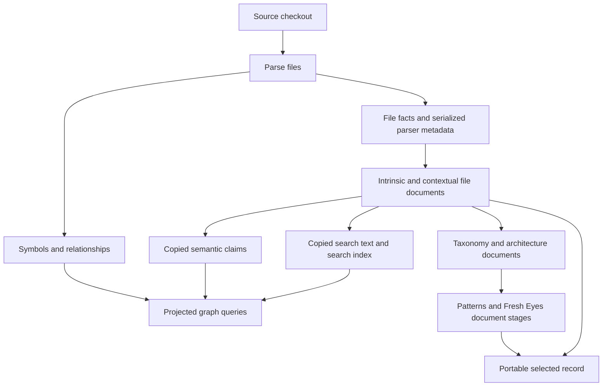
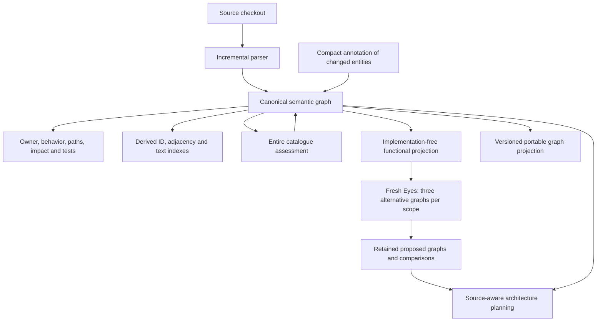
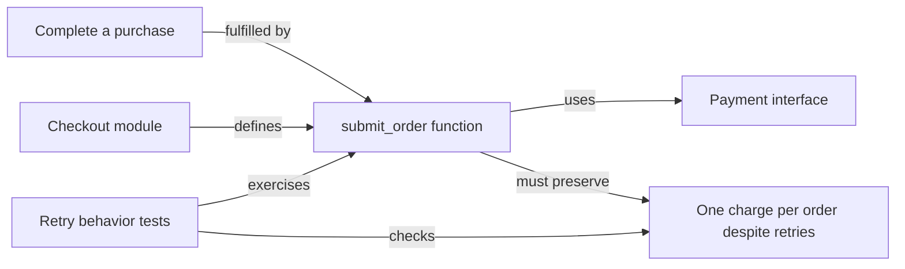

# A lightweight semantic graph for AnaxiGraph

**Status:** Semantic graph destination confirmed by the maintainer. Design and acceptance criteria;
runtime implementation is not claimed by this document.

**Design requirement:** [Full feedback and clarifications](../feedback/2026-10-23-architecture-and-storage.md).

**Frontend evaluation:** [Current surfaces, graph exploration and revised delivery order](semantic-graph-frontend-2026-10-23.md).

AnaxiGraph will make a semantic graph its authoritative knowledge model: code entities, their relationships,
what they do, the contracts they preserve, and evidence for that understanding. Reviews and plans
attach to that graph. The design should remove duplicated representations and repeated per-file
writing while preserving the coding assistance that agents already find useful.

This is a replacement of the knowledge model, not another graph view layered over the current
document pipeline. A graph data model does not require a new graph database. The recommendation is
to retain SQLite's transaction/query machinery and the existing durable executor, simplify what
they store, and preserve the current MCP and dashboard coding journeys.

## Committed destination and product objectives

The maintainer has selected the semantic graph as AnaxiGraph's destination. Delivery can be staged,
but completion means mapping, reviews, planning, agent queries and the app use that graph, and the
old parallel document pipeline has been retired. Deduplicating the existing system is useful work
on that migration; it is not the final architecture or an alternative stopping point.

The product should help developers build cohesive modules with clear interfaces, understand them
quickly, and make bounded changes without unexpected effects in unrelated areas. A smaller index
and a readable diagram support those outcomes. They do not establish that the objectives are met.
Measure correct understanding, preserved behavior, necessary changes and unnecessary interventions
as well as storage, latency and graph metrics.

## What Graphify contributes to the comparison

[Graphify's open-source engine](https://github.com/Graphify-Labs/graphify) extracts code entities
and typed relationships through local AST parsing, supports graph/path queries, and identifies
communities and highly connected nodes. It also supports rationale and non-code semantic material;
it should not be described as having no semantic capabilities. Its public output includes a
machine-readable graph and viewer/report artifacts. [Its glossary](https://graphify.com/glossary)
distinguishes graph entities, relationship provenance and traversal.

The useful principle to adopt is one inspectable, traversable representation. AnaxiGraph's proposed
model makes purpose, behavior, contracts, responsibility, catalogue assessments and alternative
architectures explicit in the same logical graph. This is a specification for AnaxiGraph, not a
claim that Graphify cannot support overlapping capabilities. No Graphify benchmark was run here.

## Today's architecture

AnaxiGraph already extracts source facts, symbols and module dependencies. The graph is primarily
a read projection over snapshot/file facts, with separate semantic documents and lookup/search
projections. Routine AI mapping produces intrinsic and contextual documents for each file.

This representation has useful operational properties: indexed search, durable completion,
paid-result reuse, revision-qualified evidence and bounded responses. The problem is that several
tables and workflow stages repeat information or exist to translate between parallel models.

The measured running service contains local compacting patches. It is schema 12; the repository's
published 0.8.5 source uses schema 11. Its parser metadata is already compressed. Improvements must
be compared with this actual current service, rather than crediting the redesign for compression
that is already present.

## Proposed semantic graph

The functional projection is a strict information boundary. Fresh Eyes receives purpose,
capabilities, required inputs/outputs, functional dependencies and constraints at product,
capability and subsystem levels. It never receives code, current implementation topology, pattern
judgments or an anonymous copy of the current design. Source-aware migration and validation stay
in Architecture Planning. Proposed graphs remain distinct from the observed graph.

### Entities and relationships

| Entity | Meaning stored once |
| --- | --- |
| Module | Stable scoped identity; source location/fingerprint; LOC/function count; one overview sentence; one short detail paragraph; interface and contract references. |
| Function, type or interface | Scoped identity, location/fingerprint, concise summary, inputs/outputs and contract references; each function has one overview sentence. |
| Capability or functional area | Purpose, responsibilities, required inputs/outputs, constraints and functional relationships. |
| Contract or scoped domain concept | Obligations, invariants, side effects, failure behavior and the scope in which a term has its meaning. |
| Evidence and provenance | Source/revision, location or observation, extraction method, confidence, model/input identity and verification state. |
| Pattern assessment | One catalogue card and declared review scope; ratings, contextual pros/cons, recommendation and evidence references. |
| Opportunity placement | A possible application of an assessed pattern to a relevant area/interface, with local trade-offs and evidence. |
| Alternative architecture | Proposed nodes/edges, functional scope, assumptions, trade-offs and comparison with the other retained alternatives. |
| Plan or verification result | Selected target, incremental changes, affected contracts, focused checks and actual verification evidence. |

Structural relationships include defines, calls, imports, implements and tested_by. Semantic
relationships include fulfills_capability, owns_state, requires_contract and supports/contradicts.
Every relationship distinguishes extraction, inference and unresolved possibilities. Proposed
relationships do not count as observed coupling. Nodes with the same name in different domains
must not be merged merely to deduplicate text.

Function-level call resolution must declare language and resolver coverage. Dynamic dispatch,
registration and reflection can leave unresolved edges. A node without resolved callers is a
candidate for investigation, not proof of dead code. High degree is similarly a question about
change propagation, not an instruction to split every useful shared component. Boundary analysis
should ask whether consumers rely on a stable contract or on provider internals.

For example, a function node can carry a sentence explaining its behavior and reference a contract
requiring one operation before another. An agent can traverse the function's callers, that contract,
the owner of the relevant state and the tests that exercise it. The meaning is part of the graph;
it does not require finding a second essay in a separate lookup system.

An illustrative map fragment, not a finding about the measured repository:

The node carries its sentence, location and metrics. The contract carries the behavioral
qualification once; both implementer and consumer refer to it. A proposed replacement has separate
nodes/edges until implementation is observed. This is the difference between semantic navigation
and displaying a dependency picture with unrelated descriptions beside it.

Descriptions are concise defaults, not a rule to delete important qualifications. A sentence is
enough for a simple function; cancellation, transaction ordering and caller obligations can require
a richer structured contract. Detailed source and evidence remain available through focused reads.

### Sentences first, progressive detail without source reads

Each module stores one `overview` sentence and one `detail` paragraph in its graph properties.
Initial authoring guidance is approximately 15–30 words for the sentence and 40–80 for the
paragraph. These are writing targets, not truncation rules. Put important obligations in linked
contracts rather than growing another per-file essay. Each function has its own overview sentence.

| Read level | Information returned |
| --- | --- |
| Inventory, search or overview subgraph | Module identities and overview sentences, with essential metrics and typed links. Detail paragraphs and full review documents are not included by default. |
| Expanded module | The short detail paragraph, relevant function sentences, interfaces and contract references, with evidence and readiness. |
| Focused behavior or contract | Callers/callees, state ownership, input/output obligations, errors, side effects, ordering and relevant tests, including uncertainty and provenance. |

The same canonical properties serve MCP, CLI, dashboard and portable records. An agent must be
able to obtain the deeper explanation from the saved graph without reopening source or asking a
model to regenerate it. Missing understanding is reported explicitly. Source remains available to
the coding agent for implementation and verification. Preserve the small response budget, paging
and full counts; do not force agents to read every paragraph or make one call per graph node.

### Graph analysis that improves modularity and change isolation

Graph observations should drive specific architectural questions. Track distinct consumers,
incoming/outgoing relationship types, cross-boundary dependencies, cycles, responsibility clusters,
shared mutable state and dependencies on another component's internals. Keep executable consumers,
tests and documentation separate in counts; repeated edges do not become distinct callers.

A node with 100 incoming connections deserves examination. It might combine unrelated
responsibilities or expose unstable internals, making changes ripple through many areas. It might
also be a cohesive utility consumed through one stable contract. Compare responsibility separation,
boundary ownership and alternatives before recommending a split. Fewer edges, files or lines alone
are not the goal; a useful interface can add edges while reducing knowledge shared by its callers.

For each improvement recommendation, identify the affected nodes and contracts, the graph evidence,
competing approaches and contextual pros/cons. Explain expected changes in propagation, new
complexity or indirection, migration consequences and focused verification. Keep scope and unknowns
explicit. Static reachability, predicted behavioral impact and verified change effects are separate.

Patterns and Architecture Planning can inspect the actual graph, question dense nodes and look
for better boundaries. These signals guide placement and deeper investigation while every loaded
catalogue card is still assessed. Fresh Eyes receives only the implementation-free functional
graph and develops alternative designs. Planning subsequently compares those designs with the
actual graph; actual degree counts or implementation topology must not leak into Fresh Eyes.

### What happens to lookup tables

There are two different things currently called lookup:

1. `semantic_claims` stores another copy of module-analysis JSON. The measured dataset has 5,196
   such copies, all matching the corresponding document value. This duplication should disappear.
2. An index maps an ID, word or relationship endpoint to the right entity. These are useful for
   fast queries and should remain, referring to canonical graph properties instead of storing
   another full description.

The proposed runtime has one canonical payload for each entity/relationship. ID and adjacency
indexes contain keys/references. Full-text search retains useful names, aliases, responsibilities
and contracts, using a contentless or external-content index over canonical information. Removing
search entirely would risk making behavior discovery worse for agents.

The graph itself can be stored in ordinary SQLite node/edge/property records. Avoid an EAV design
that creates one row or node for every word/property: it can increase size and query complexity.
Avoid introducing Neo4j, a vector store or a generic workflow engine for this redesign.

### Physical storage choices

| Choice | Benefit | Cost or risk |
| --- | --- | --- |
| Previously considered: keep today's knowledge model and deduplicate | Removes measured copies while retaining mature readers. | This does not deliver the selected semantic graph destination. Deduplication may be a migration task, but completion cannot stop here. |
| **Target: local SQLite property graph plus a portable graph projection** | Reuses transactions, incremental writes, query machinery and durable workers. Removes full-payload lookup/search copies without building a custom storage engine. | Local and portable encodings both consume disk; both must be counted. Exact final bytes depend on the chosen schema and index layout. |
| File-first JSONL graph with a small derived index | One canonical file representation can serve both Git and local reads; an offline encoding experiment can measure it before a runtime exists. | Incremental atomic updates, concurrent reads and indexing need design work. Rewriting a whole graph after each model result could be much slower. |
| Compressed graph archive as the runtime | Small transport artifact. | Whole-file gzip is not seekable; counting only its compressed bytes hides decompression, memory or an additional uncompressed copy. It is not the recommended runtime. |

Portable records should contain bounded, stable partitions and a versioned manifest. The installed
app renders the graph; each repository need not contain another full HTML/JSON data copy. Existing
record/import/commit delivery states remain separate. Jobs store revision-qualified references and
completion state rather than repeated catalogue cards and large request bodies.

Prefer deterministic JSON/JSONL partitions for the current semantic record so Git changes remain
inspectable; compress the cold legacy archive and optional transport bundles. The all-record gzip
and XZ experiments below test representation costs, not this final partition policy. Compressed
partitions can reduce transfer size while weakening readable diffs and Git delta efficiency.
Stable partitions and unchanged-save reuse matter more than minimizing one archive in isolation.

### What lives where

| Location | Contents and retention |
| --- | --- |
| Tracked `anaxigraph/` | Current graph identities, compact semantics/contracts, useful typed relationships, selected reviews/alternatives/plans and their provenance. Manifest includes file fingerprints, analyzed revision, schema/catalogue/prompt identities and separate readiness. Relative identities survive another clone path. |
| Local SQLite | Queryable canonical graph plus useful derived indexes, local work state and a bounded source-parser cache. Opaque parser IR and machine/worker state do not travel through Git. Compatible analyses are reused after source-fingerprint validation. |
| Retained legacy results | Original explicitly saved analysis values and provenance remain readable through a compressed compatibility archive during migration. Its bytes count in the total; it is not a hidden second permanent database. New analysis writes the new model. |
| Historical baseline | Current graph plus a bounded comparison checkpoint by default; pinned decisions and explicitly saved analyses remain. Older source is available through Git, but old semantic meaning must retain its own revision/provenance. Detailed mapping history is opt-in. |

Proposed publication bounds are one manifest and at most 32 data partitions by default, using stable
identities and checksums. Unchanged saves must write no new data or timestamps. Check total bytes,
file count and temporary space before publishing; replace the manifest only after validation, keep
the last valid record on failure and remove failed staging output. Exclusions apply to current
exported entities, including rows retained by older scans. Do not omit an assessment to fit a limit.

Use the maintainer's approximately **100,000,000-byte active-state target**, counting graph, indexes,
parser cache, local portable copy and retained legacy results together. The configured absolute
ceiling must not exceed **200,000,000 bytes**. Evict rebuildable cache first; preserve explicit saved
work and report an unmet budget instead of silently truncating it. A verified migration backup is
reported separately, including its temporary peak footprint; it is never described as free storage.
These are proposed budgets, not measurements of a future implementation.

The active-record budget does not bound `.git` history. Nightly commits can accumulate substantial
history even when the current folder is small. Measure changed bytes and Git pack growth across
repeated updates; keep rebuildable parser IR and transient state out of the tracked record. Do not
claim local retention fixes Git-history bloat or rewrite repository history as part of migration.

### What the user and coding agent see

The [frontend evaluation](semantic-graph-frontend-2026-10-23.md) is a required part of this design.
Preserve the sortable module table and manual workflow workspace. Keep the existing task journeys,
combine table/graph entity inspection, rebuild graph exploration around typed relationships and
focused expansion, and align review results and Changes with the new knowledge/retention model.
Define those frontend contracts before finalizing graph queries and schema; the frontend is not
a cosmetic follow-up once the backend migration is finished.

The map opens at product/capability level and expands into modules, interfaces, functions and tests.
Selecting a node shows its sentence, metrics, contract, incoming/outgoing typed links and evidence;
important detail expands in place. A behavior search returns a focused path/subgraph with owners
and tests. Keep today's compact MCP defaults and full-detail/pagination options so agents do not
need a series of tiny calls to reconstruct an ordinary impact answer.

The existing workflow cards remain. Mapping distinguishes structural readiness from annotation
coverage. Patterns shows assessed/reviewed/expected catalogue IDs, including unresolved evidence,
and offers every rating/pro/con in a paged table. Fresh Eyes shows the functional scope and its
three retained design graphs side by side. Architecture Planning separately shows actual versus
selected target, with retained/moved/added/removed boundaries and migration checks. Optional user
direction and agent-selected defaults remain supported.

This replaces routine intrinsic/contextual essays with a compact entity annotation plus contract
and boundary review; removes full-payload claim copies and the extra stored FTS content; and
replaces repeated taxonomy/review snapshots with revision references and actual changes. It reuses
the current API, queue, worker, parser and dashboard owners. It does not add a parallel graph
service or keep the old document pipeline producing a second full map indefinitely.

## Workflow changes

| Workflow | Today | Proposed |
| --- | --- | --- |
| Mapping | Structural graph plus two completed file-description stages, followed by higher-level synthesis/review. | Graph usable immediately; compact module/function semantics, contracts and ownership enrich changed entities in bounded batches. Annotation coverage is separate from structural readiness. |
| Patterns | Preselected pattern/target pairs and document-based assessments/reviews. | Every loaded catalogue card has a contextual assessment, ratings, pros/cons and evidence-linked opportunities. Priority orders deeper work; it never removes initial consideration. |
| Fresh Eyes | Flat brief, proposals, one reference design, existing-system comparison and mission filter. | Implementation-free functional hierarchy, three retained alternative graphs per reviewed level, and comparison against functionality. Five sketches may be an optional exploration setting. |
| Architecture Planning | Combines mapping and reviews into options/targets/milestones. | Retains source-aware comparison and rejection of unsuitable proposals; consumes actual and proposed graphs with explicit contracts and evidence. |
| Agent coding loop | Locate owner, inspect dependencies/tests, edit, rescan and reassess. | Preserve the same loop and compact tool contracts; add finer function/interface traversal and clearer evidence. |

Reuse compatible annotations and available docstrings/signatures. Batch changed or missing
annotations per module; do not turn every symbol into a separate paid request. Cross-module
consistency review focuses on changed contracts and boundaries. Initial and incremental model work
need separate measurements: a structural graph can be ready while richer annotation remains pending.

The catalogue is an explicit search space, not a request to volunteer a few ideas. Each loaded ID
must be accounted for, with current conformance separate from potential benefit. A useful pattern
need not fix a bug. The shared-agent/provider abstraction is one positive case among many families.
Store one assessment revision and refer to it from reviews; create a new revision when its content
changes, rather than copy the full assessment on every pass.

Snapshot the loaded catalogue fingerprint and expected ID set, including custom cards. Count
considered, rated, reviewed, unresolved and missing separately. Link any opportunity placements
to the assessment; do not require a pattern-by-every-function Cartesian product. Poor fit is an
assessment outcome, while missing or insufficient evidence remain distinct states.

In the measured run, 200 completed assessment/review pairs cover **97 distinct catalogue IDs**.
The current source and installed catalogues have **133 cards**, with **36 absent from the run**;
their full-content fingerprint matches the fingerprint saved in the run's candidate metadata.
The old manifest stores that fingerprint, not an explicit complete ID list/count. Completed recommendations are 140
`no_action`, 29 `retain`, 11 `avoid`, 18 `insufficient_evidence`, two `improve_conformance` and zero
`introduce`/`replace`. This is evidence of incomplete catalogue consideration, not proof that a
particular recommendation is wrong. The proposed completion check compares actual IDs with the
catalogue manifest, independently of pagination, ranking and display budgets.

Fresh Eyes uses a fresh context and a capability-restricted worker at every stage; prompt wording
alone cannot enforce blindness. A brief contains functionality and required behavior, not current
module names, provider choices or topology. Child alternatives refer to their proposed parent's
constraints. They do not require enumerating every combination of all parent/child alternatives;
the selected scopes and unresolved coverage are explicit. Comparison judges requirements and
trade-offs without selecting one universal winner. Source-aware planning can later reject all
three or choose a target; that decision does not erase the Fresh Eyes alternatives.

The brief schema permits only functional-scope IDs, parent functional scope, purpose, capabilities,
required inputs/outputs, behavioral constraints, functional dependencies, requirement origin
(declared/inferred) and uncertainty. Scope construction follows capabilities, not source folders,
existing service boundaries or the implementation taxonomy. User-required integrations such as
Shopify and MCP are legitimate functionality; the present internal provider or framework choice
is not. Source pointers and evidence stay outside this view and cannot be followed by its worker.

Each alternative identifies its scope, immutable brief revision and proposed parent constraints.
Report composition conflicts instead of silently merging incompatible child designs. Reuse results
when the functional brief is unchanged despite implementation edits; changed requirements
invalidate affected scopes. Retain prior brief/alternative revisions for historical comparisons.

Executors must provide fresh sessions without source tools, repository mounts or inherited coding
context. An executor that cannot enforce that boundary reports an unverified isolation state; its
output cannot be claimed as a verified blind review. Validate every stage with canary implementation
details excluded from packets and inaccessible through tools. The historical review documented
same-session and host-context exposure, so packet filtering alone is inadequate evidence.

Keep the existing queue, lease recovery, ordered review dependencies, parallel independent work,
immediate checkpointing and failed-only retries. A smaller data model must not reintroduce the
repository-wide planning and restart failures previously repaired.

## Measured complete baseline and format experiments

The baseline is a completed MaxOS run, not a structural-only fixture or a floThink measurement:
2,598 files, 21,097 symbols, 26,336 relationships, 5,872 saved analysis documents, 200 completed
pattern assessments and 200 reviews, and completed legacy Fresh Eyes stages. It has one source
snapshot. Those documents include paid model outputs and deterministic grounding. Measurements
used read-only SQLite access; the live service and results were not changed. With one snapshot,
this remaining footprint cannot be explained simply as unbounded historical scanning.

All figures below are bytes, not rounded MB. Logical JSON sizes are not added to physical-table
sizes: they describe information already inside those tables.

| Current stored item | Exact bytes |
| --- | ---: |
| Local database | 121,761,792 |
| Portable record across 12 files | 4,945,380 |
| Database plus portable record | **126,707,172** |
| WAL at measurement | 0 |
| Shared-memory file | 32,768 |
| Three small recovery-verification reports | 1,541 |
| Total including those shared-memory/report files | **126,741,481** |

| Current physical table or search component | Exact bytes |
| --- | ---: |
| Semantic documents, across all kinds | 31,502,336 |
| Copied semantic claims | 17,944,576 |
| Parser/file facts | 14,766,080 |
| Search's stored content copy | 13,447,168 |
| Relationship edges | 9,203,712 |
| Search index data | 5,578,752 |
| Symbol facts | 4,833,280 |
| Findings | 4,407,296 |

These components exclude their other indexes; they are not a complete sum of the database. Only
1,204,224 bytes are wholly free pages. Vacuum may repack some additional space, but cannot remove
live duplicate payloads.

| Saved model-output values, logical JSON only | Exact bytes |
| --- | ---: |
| Intrinsic module descriptions | 4,960,722 |
| Contextual module descriptions | 4,385,083 |
| Pattern assessments | 1,141,711 |
| Pattern reviews | 1,775,371 |
| Legacy Fresh Eyes proposals | 29,227 |
| Fresh Eyes adjudication | 23,019 |
| Fresh Eyes existing-system comparison | 28,151 |
| Fresh Eyes final review | 8,934 |
| Fresh Eyes grounding | 2,815 |
| All Fresh Eyes output values | **92,146** |
| Taxonomy proposal and reviews | 8,005,593 |
| All saved analysis-document values | **20,420,655** |

The 5,196 claim values repeat **9,345,805 bytes** of intrinsic/contextual JSON exactly. Supporting
evidence is also stored separately; taxonomy review values repeat substantial taxonomy structure.
Those repetitions are more important than the small Fresh Eyes outputs themselves.

The [aggregate measurement evidence](../../benchmarks/results/semantic-graph-design-2026-10-23.json)
records format-only experiments on the same complete dataset. No private analysis payloads are
checked into this repository. A scratch SQLite container compresses each retained record once,
links duplicate claim content back to its document, and retains contentless search, adjacency and
ID indexes. It is a storage feasibility experiment, **not an implemented semantic-graph API**.

| Representation | Local queryable bytes | Portable bytes | Combined bytes |
| --- | ---: | ---: | ---: |
| Today's complete patched-service storage | 121,761,792 | 4,945,380 | **126,707,172** |
| Offline record container plus gzip graph projection | 52,879,360 | 18,601,062 | **71,480,422** |
| Same container plus XZ graph projection, alternative codec | 52,879,360 | 14,410,920 | **67,290,280** |

The gzip variant is **43.59% smaller overall** and the XZ variant **46.89% smaller overall**.
Both encodings count local and portable copies; only one portable codec would be retained.
Shared-memory files, update WAL, staging and migration backups must also be budgeted in a runtime.
The scratch database figures are static, closed-database sizes, not peak operational footprints.

The experiment retains 92,132 rows, including every current file, symbol, relationship and all
5,872 saved analysis documents with their original values and provenance. Strict per-table
round-trip checks match retained original rows. Twenty module/neighborhood lookups and four FTS
queries matched the original artifact IDs. The claim's one differing supporting-evidence field is
preserved rather than discarded by deduplication.

It deliberately omits rebuildable search-content/shadow tables, the local import-ID map, active
worker/lease state, empty checkpoint caches and most Git-log rows; latest known change dates for
2,594 current files remain. It therefore preserves current understanding and saved analysis, not
all database history. Historical co-change queries would need a local rebuild. No concurrency,
incremental-write, full agent-task or recommendation-quality parity was established.

The **portable artifact gets larger**, not smaller. Today's selected record decodes to
41,661,184 bytes; the experimental fuller graph projection is 65,011,579 bytes. With the same gzip
codec they are 7,669,567 versus 18,601,062 bytes. The real existing record uses XZ; the experimental
whole projection also compresses to 14,410,920 bytes with XZ preset 6. Different partition layouts
and different contents mean these are not a claim that a production portable format has improved.

The final recommendation excludes opaque rebuildable parser IR from the portable graph. The
conservative experiment retained it and every legacy output so retention could be checked first.
Repacking old records alone does not implement the smaller semantic core, new function contracts
or revised review workflows. It establishes that substantial representation savings are possible
without deleting saved analysis; a final graph conversion must be measured again.

For comparison, a simpler flat JSONL plus derived index occupies 71,778,171 queryable bytes before
adding its portable archive. Whole-file gzip plus index is only 25,367,654 bytes, but is **not a
seekable runtime**. Recursive value interning made compression worse and was rejected. Neither a
diagram nor the word "graph" guarantees smaller storage.

Exact future sizes for new function annotations, all-catalogue reviews and hierarchical Fresh Eyes
cannot be measured before those outputs exist. Compare the same existing facts/results first,
then give future additions explicit byte budgets and separately labelled estimates. A new graph
portable record may be larger than today's semantic-only projection because it includes more facts.

Fewer repeated file-description passes could reduce model work. Exhaustive catalogue coverage,
function annotations and multiple alternatives could increase it. The 25.067-second scratch
container build and 39.208-second XZ compression measure local format operations, not a replacement
for the reported seven-hour workflow. No new live model run was performed or speedup demonstrated.

## Would coding agents be better off

The strongest prior feedback was that AnaxiGraph helps find existing owners, dependencies and
relevant tests—not that it has demonstrated fewer bugs or faster delivery. That coding loop is the
replacement's acceptance target. See [actual usage feedback](../feature-development-plan.md#usage-feedback-and-repair-queue--20-october-2026).

| Agent-valued behavior | Potential gain | Potential loss or regression to prevent |
| --- | --- | --- |
| Find behavior owners, dependencies and tests | Direct semantic/function/interface links reduce reconstruction work. | Removing aliases, indirect edges or test associations makes the tool less useful even if smaller. |
| Understand contracts and caller obligations | Store each contract once and link owners, consumers and checks. | A one-line description can omit transaction order, side effects, cancellation and failure behavior. |
| Search by meaning and domain vocabulary | Scoped capability/concept nodes can improve relevant retrieval. | Removing FTS or merging similarly named concepts across domains damages recall and disambiguation. |
| Trust evidence | Inspectable facts, inference and verification states attach directly to graph entities. | A clean-looking inferred edge must not become a verified fact or turn unknown confidence into zero. |
| Resume paid work | Jobs refer to canonical evidence, reducing copied metadata and repeated preparation. | New IDs or schemas could invalidate compatible results or break atomic completion/restart. |
| Compare changes | Fine-grained node/edge revisions can make impact clearer. | A mutable current graph can overwrite the meaning of an old baseline; Git source history alone is insufficient. |
| Get useful criticism | Catalogue coverage and retained alternative graphs broaden the questions evaluated. | More ratings or more alternatives do not prove better judgment; compact evidence may still omit a decisive constraint. |
| Receive small, fast responses | Focused subgraphs and canonical references can reduce response construction. | File-backed joins/decompression or too many tool hops can be slower than today's indexed SQLite reads. |

The [September multi-model review](../fresh-eyes-multi-model-review-2026-09.md#cross-generation-reading)
is important counterevidence to blind redesign advocacy: several models agreed on a non-issue,
and source inspection rejected attractive changes while confirming other real defects. Preserve
that source-aware validation outside Fresh Eyes. Multiple proposals or graph structure cannot
substitute for checking consequences.

The [operational handoff](../semantic-bootstrap-p0-handoff.md#resolution-update) documents why
linear queue planning, durable workers and restart reuse matter. The [book-review synthesis](../reviews/books-2026-09-11/00-synthesis-and-refactoring-plan.md#agent-specific-follow-up)
warns that smaller functions, extra documentation and richer schemas are task-dependent benefits.
The redesign must earn its replacement claim on agent tasks, not appearance or file size alone.

## Gains and losses to accept deliberately

Expected gains are fewer duplicate payloads, fewer routine description stages, a consistent semantic
query model, richer function/contract navigation, explicit catalogue coverage and genuinely blind
hierarchical design alternatives. Storage experiments can establish representation savings; they
cannot establish recommendation quality, faster model execution or fewer bugs.

Costs include migration risk, changes to mature readers, possible cold-query/search regressions,
larger portable graphs if more source facts travel, and fewer immediately available historical
graphs if retention is reduced. Preserving original annotations for recovery also costs bytes.
Do not hide an archive or decompressed graph when reporting the new total.

Much of the storage gain could be achieved by removing duplicates in today's implementation.
Catalogue coverage and Fresh Eyes boundaries can also be corrected without waiting for a complete
storage rewrite. The stronger reason for changing the knowledge model is coherent function,
contract and behavior traversal. These improvements contribute to the committed migration; they
do not replace it. Failed acceptance cases identify problems to fix in the graph implementation,
rather than making retention of the legacy knowledge model the planned endpoint.

The replacement must preserve contracts, domain scopes, evidence, aliases, relevant tests, exact
checkout identity and explicit baselines. An aggressively abbreviated diagram can be worse for
coding agents and does not satisfy the selected semantic graph design.

## Product acceptance for the rewrite

These are required scenarios for the replacement, not results already demonstrated. Use controlled
cases with known dependencies and obligations, and matched real maintenance tasks. Include positive
opportunities from several catalogue families and healthy controls, rather than one preferred pattern.

| Scenario | Required outcome |
| --- | --- |
| Quick understanding followed by detail | Default inventory exposes module sentences. Expansion supplies the short paragraph, function sentences and linked contracts from saved graph data without source reads or new model calls. |
| Trace behavior across a boundary | The agent can follow the relevant function/interface path, identify ownership and caller obligations, and find the tests that exercise them. Unknown dynamic links stay explicit. |
| Change frontend presentation without changing a public contract | Identify actual local consumers and relevant tests without inventing unrelated backend edits. Existing backend dependencies remain visible without automatically becoming required changes. |
| Change an implementation behind a stable interface | Identify the exposed contract and its checks. Preserve caller-visible behavior in the fixture; callers do not require unrelated rewrites. |
| Deliberately change a public contract | Identify affected producers/consumers, broken obligations, necessary companion changes and compatibility/migration checks. Legitimate cross-boundary consequences must not be hidden. |
| Review an overloaded dependency hub | Explain distinct responsibility clusters or internal dependencies and offer useful decomposition/boundary alternatives, with pros/cons and verifiable expected effects. |
| Review a healthy high-degree utility | Recognize its cohesive role and stable interface; avoid unnecessary splitting, wrappers or service extraction solely because of connection count. |
| Assess patterns and explore fresh designs | Account for every catalogue ID and placement evidence; retain three materially different functional alternatives per reviewed Fresh Eyes scope without exposing the existing implementation. |

Compare correct affected scopes, missed contracts, unnecessary changes, behavior preserved and the
effort required to reach a correct decision. A frontend change is not assumed isolated merely
because an interface is drawn: trace its actual obligations and check the behavior. Record which
conclusions were structurally derived, inferred or exercised. No claim of production robustness
follows from graph shape alone.

## Migration sequence and completion criteria

1. Specify the target graph schema, progressive description fields, input boundaries and retention
   policy around the confirmed product objectives and audited frontend journeys. Define shared
   entity selection, global table sorting/pagination, focused graph reads and result-state contracts
   first; deliver an early graph → module table → shared inspector → focused exploration slice.
2. Validate lossless conversion of existing paid results and required facts, with all copies and
   indexes included in footprint comparisons. Keep recovery explicit and bounded.
3. Compare matched agent tasks on the same revisions and budgets: locate behavior, trace impact,
   identify tests, preserve a contract, recognize useful catalogue opportunities and reject bad advice.
4. Measure correctness, missed obligations, unnecessary changes, query/startup latency, memory,
   changed-write volume, Git pack growth over nightly updates, model usage and storage. Keep
   healthy controls and disagreement.
5. Move all producers/readers onto the semantic graph while preserving tool contracts and queue
   reliability, sortable inventory, manual workflows, baseline identity and accessible exploration.
   Finish by removing the old duplicate pipelines; a compatibility adapter or phased
   rollout is delivery machinery, not a second permanent architecture.

No production code, live index or published release is changed by this design work. The maintainer
has confirmed the destination and clarified the product outcomes. This update specifies their
acceptance criteria; it does not claim that runtime migration or measured benefits are complete.
