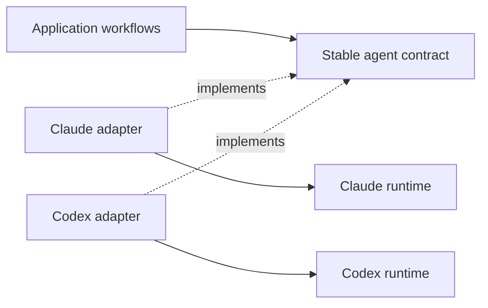

# Graph purpose and architectural judgment

**Date:** 23 October 2026

**Status:** Analysis and proposed changes

**Source baseline:** `843f4c8015560f483dd76ddd4f4d447a4daaa0a2`

**Maintainer direction:** [Complete feedback and original wording](feedback/2026-10-23-architecture-and-storage.md)

AnaxiGraph should provide a compact, navigable graph of code and contracts that helps developers
understand behavior, predict the consequences of changes and discover worthwhile improvements.
Architectural reviews should investigate that graph and test competing explanations. A completed
seven-hour workflow, a large description inventory and a cache below a ceiling do not establish
those outcomes.

The code audit identifies restrictions in candidate discovery, available evidence, alternative
comparison and evaluation. These are concrete reasons to investigate the harness before attributing
the reported failures entirely to a model's ability to apply knowledge. The proposed changes below
need measured evaluation on known misses and healthy controls.

## The map as the primary product

The maintainer describes the map as roughly 90% of the intended product. Its core should include:

- Module and function identities, locations, LOC and function counts; public interfaces and contracts.
- Typed links for imports, calls, implementations and data ownership where supported by evidence.
  Static dependencies, observed runtime calls, inferred functional relationships and unresolved
  dynamic links must remain distinguishable.
- One short module overview, a small paragraph for important behavior, and a sentence explaining
  each function. Existing docstrings and signatures should be reused; missing semantic annotations
  can be generated in bounded batches for changed code and expanded on demand.
- Traversal from a user operation through owners, calls, state changes, callers and relevant tests.
  A readable overview should expand into focused subgraphs.
- Source fingerprints, evidence locations, confidence and explicit unknowns. A graph can be useful
  before every AI annotation is finished; structural readiness and annotation coverage are distinct.

The existing deterministic graph is the starting point. Extending it should preserve one source of
facts and one query model rather than introduce another graph database or parallel analysis product.

## What the current code actually does

These observations concern the inspected AnaxiGraph source. They do not establish which stage
failed in the cited floThink run; its actual requests, results and database need separate tracing.

| Observed behavior | Why it matters | Evidence |
| --- | --- | --- |
| Fresh Eyes defaults to two proposals and clamps the supported count to three. | A prompt requesting five alternatives cannot change the current contract by itself. | [Proposal controls](../src/anaxigraph/semantic_fresh_eyes_contract.py#L27) |
| Proposal slots receive the same design instructions; different executors do not enforce different boundary or state choices. | Several proposals can converge on the same architecture with different wording. | [Proposal requests](../src/anaxigraph/semantic_fresh_eyes_requests.py#L25) |
| Adjudication produces one reference design before the current-system comparison. That comparison receives the reference, not every original alternative. | An interesting minority design may never receive an as-built comparison. The saved originals still exist. | [Comparison input](../src/anaxigraph/semantic_fresh_eyes_requests.py#L102), [adjudication contract](../src/anaxigraph/semantic_fresh_eyes_contract.py#L188) |
| Fresh Eyes comparison uses at most 80 module descriptions, 30 group summaries, 30 pattern results, 120 dependency links and 40 findings; it does not include raw module source. | Completion is not exhaustive inspection. A summary packet can omit the evidence for an obvious issue in a large repository. | [Packet builder](../src/anaxigraph/semantic_fresh_eyes_evidence.py#L35), [module selector](../src/anaxigraph/semantic_evidence_selection.py#L121), [links](../src/anaxigraph/semantic_fresh_eyes_evidence.py#L460) |
| The final mission review receives the comparison and brief, rather than the original current-system packet. | Successive summaries can lose evidence and disagreement. | [Final review input](../src/anaxigraph/semantic_fresh_eyes_requests.py#L112) |
| Patterns starts from catalog pattern/target pairs. Its default policy allows four per target, 200 overall, minimum priority 25. Pairs without positive signals or sufficient priority are skipped before model assessment. | Assessment wording cannot recover a problem that candidate selection excluded. | [Candidate policy](../src/anaxigraph/pattern_candidate_models.py#L18), [prefilter](../src/anaxigraph/pattern_candidate_selection.py#L101) |
| For constructive patterns, suitability at least 70 and conformance at least 80 require retain/no_action, with opportunity at most 40. | Correctly using a pattern and having the right architectural boundary are different questions. Keep protection against pointless replacement while adding independent problem diagnosis. | [Validation](../src/anaxigraph/pattern_evaluation_contract.py#L280) |
| The pattern reviewer sees the first assessment. Parent evidence uses up to eight source witnesses and can miss important functions inside a witness file. | This is critique of a supplied hypothesis, rather than blind independent discovery. | [Assessment supplied to review](../src/anaxigraph/semantic_pattern_requests.py#L44), [witness selection](../src/anaxigraph/semantic_pattern_requests.py#L166) |
| The model-quality fixture supplies the pattern and target. Five of ten cases expect retention, one remediation, two negative and two uncertain; none are positive introduction/replacement cases. Its known_positive_misses metric counts retention cases. | That benchmark does not demonstrate end-to-end discovery of overlooked improvements. | [Benchmark](../benchmarks/architecture_judgment.py#L26), [metrics](../benchmarks/architecture_judgment.py#L106), [cases](../benchmarks/fixtures/architecture-judgment.json) |
| Graph projection is module/artifact based and excludes symbol nodes. Edge endpoints are artifacts, without first-class source/target function IDs. | Symbols are stored, but the requested function-to-function and interface-aware traversal is incomplete. | [Projection](../src/anaxigraph/persistence/graph_projection.py#L10), [node details](../src/anaxigraph/persistence/graph_node_detail.py#L33), [schema](../src/anaxigraph/persistence/temporal_schema.py#L20) |
| Any dynamic relationship can suppress dead-code analysis repository-wide. Configurable defaults also require at least 95% resolution and a known candidate last-change date older than 90 days. | No findings can mean analysis was suppressed. Disabling historical mapping makes missing age evidence an important case to test. | [Global eligibility and defaults](../src/anaxigraph/architecture_dead_code.py#L40), [candidate age](../src/anaxigraph/architecture_dead_code.py#L105) |

The deterministic foundation already includes metrics, interfaces, symbols, typed dependencies,
cycles and impact traversal with relevant tests. [Impact analysis](../src/anaxigraph/agent_impact.py#L119)
and [boundary rules](../src/anaxigraph/architecture_rules.py#L268) should support the core product.
Their existence does not yet prove behavioral isolation or executable contract preservation.

### Existing protections to retain

Supported dashboard workflows preserve the original mapping configuration while planning review
prerequisites. An existing test checks that Patterns leaves mapped module document IDs unchanged.
Standalone `patterns` reads saved results; standalone Fresh Eyes also passes the original mapping
configuration through. Do not diagnose the seven-hour run as an automatic detailed remap without
its actual configuration and job history. A deliberate `detailed_reviews: false` to `true` change
followed by generic bootstrap can invalidate file analyses because that mode participates in their
input hashes. See [workflow guard](../src/anaxigraph/workflow_execution.py#L155),
[regression test](../tests/test_workflows.py#L78), [Fresh Eyes planning](../src/anaxigraph/semantic_fresh_eyes_review.py#L117)
and [file input identity](../src/anaxigraph/semantic_module_intrinsic.py#L79).

## Storage should follow the knowledge model

The reported 4.95 MB portable record and 122 MB cache describe different representations, so their
sizes need not match. Nevertheless, fitting under the 200 MB ceiling does not establish efficiency.
Source defaults remain 64 MB for the index and 100 MB for active state; 122 MB exceeds those
defaults. The run's effective budgets and the contents of its reported cache still need measurement.
See [storage policy](../src/anaxigraph/storage_policy.py#L11).

The current baseline still generates intrinsic and contextual file documents. Their JSON is also
copied into `semantic_claims`, with supporting evidence separately stored, and selected text is
indexed for search. IR serialization already removes some derivable metadata, so this is not a
claim that every fact is completely uncompressed. See [result persistence](../src/anaxigraph/semantic_results.py#L142),
[claim schema](../src/anaxigraph/persistence/schema.py#L142), [search projection](../src/anaxigraph/persistence/search_read.py#L240)
and [IR compaction](../src/anaxigraph/ir_serialization.py#L124).

Before choosing another storage limit, collect a read-only breakdown from the actual owning index:

1. Effective storage configuration, SQLite `dbstat` bytes for each table and index, row counts,
   and JSON bytes by document kind.
2. Page count, free-page count and WAL bytes, distinguishing live data from reclaimable space.
3. Current versus retained generations, canonical documents versus copied claims, and FTS bytes.
4. Portable-record files, recovery copies, worker logs and temporary output measured separately.
5. Bytes per module, symbol and edge, plus real query/import latency. A smaller file that makes
   every query expensive is not a demonstrated improvement.

| Information | Proposed representation |
| --- | --- |
| Source-derived nodes, metrics, signatures and typed links | One canonical fact representation; rebuild locally and expand symbol views as needed. |
| Module/function descriptions and contracts | One concise canonical annotation; store contextual deltas and cross-boundary findings rather than another full essay for every file. Preserve original saved analyses through migration. |
| Claims and search | Reference canonical documents. Evaluate views and external-content/contentless FTS against current correctness and latency before replacing copies. |
| Architectural alternatives, findings and selected plans | Compact structured artifacts with exact evidence, trade-offs, provenance and verification status. |
| History and runtime state | Git history for portable results, bounded local checkpoints and logs, and explicit recovery retention. |

## Suggested prompt replacements

These are drafts for evaluation. They change the question being asked, rather than merely request
a harsher tone. Model-facing schemas, proposal-count controls, evidence retrieval, freshness
versions and the comparison sequence must support the requested behavior.

### Fresh Eyes exploration

```text
Using only the capability brief, observable behavior and hard constraints, propose five compact,
functionally equivalent architecture alternatives. Vary ownership, state,
dependency-direction, control-flow or extension boundaries. Renaming components is not diversity.
For each: give a small graph, key responsibilities, preserved interfaces, its strongest advantage,
its strongest failure mode, assumptions, and the conditions under which it would beat the others.
Keep the proposals independent and preserve them all. Do not merge or select a winner yet.
If fewer than five defensible alternatives fit the constraints and budget, explain the missing
design space rather than fabricate another design. Infrastructure requires a workload reason.
```

Generate concise sketches, not five full rewritten codebases. Preserve the implementation-blind
proposal stage. At the later repository-aware stage, compare every viable alternative with the
current design under the same requirements; randomize labels/order where practical. Defer final
selection or synthesis until this comparison, retaining useful disagreements and rejected options.

### Problems before pattern names

```text
Trace a concrete user operation and a representative future change through this subgraph.
Look for changes escaping their intended boundary, conflicting state ownership, responsibilities
that belong elsewhere, and callers depending on provider or storage implementation details.
For each suspected problem give exact source evidence, a dependency/state path, a failure or
change scenario, contrary evidence, and the smallest check that could disprove the diagnosis.
Compare keeping the design, simplifying it and moving a boundary before naming a pattern.
Use a catalog pattern only when it improves the proposed solution. State missing evidence.
```

This requires an open problem-discovery step and targeted graph/source inspection. It cannot be
implemented by replacing text inside a request whose candidates are already fixed pattern pairs.
Distinguish local pattern conformance from the quality of the surrounding architecture.

### Strong critic with a falsification task

```text
Construct the strongest defensible criticism of each important boundary, including each proposed
alternative. Describe the concrete mechanism, affected callers, and a scenario where it matters.
Try to disprove your criticism using source, contracts, tests, runtime registration or workload
evidence. Give the best argument for retaining the boundary too. Unsupported criticism remains
a hypothesis. Do not require a minimum defect count or assume the current system is optimal.
Return the few findings with the strongest evidence and the most useful next experiments.
```

A blind investigator can diagnose the same scoped evidence before seeing the first assessment.
A subsequent reviewer can challenge both diagnoses. Calling a pass independent should identify
which prior conclusions it could see and whether it fetched additional evidence.

### Compare alternatives through changes and failures

```text
Compare every surviving design, including the current implementation, against the same concrete
behavior, growth, change and failure scenarios. Show affected owners, dependency paths, contract
risks, focused tests and migration effort. Preserve disagreements instead of averaging designs.
Prefer the smallest reversible experiment that would resolve the most important uncertainty.
Distinguish expected benefits from measured results. Retaining the current design is valid when
it wins these comparisons; workflow completion alone is not evidence that it wins.
```

## The agent interface as a robustness example

The following illustrates the maintainer's desired boundary; it is not a discovered floThink diagram.
Solid arrows mean uses; dashed arrows mean implements.



Use representative changes—provider SDK response shape, cancellation, streaming, errors and
capability differences—to ask which modules should change and which should remain unaffected.
Run the same caller-facing contract checks against both adapters; verify differences exposed by
the contract rather than promise identical provider behavior. Compare predicted and actual edit
scope, tests and behavior. Static boundary rules support this investigation; executed tests establish
behavioral evidence. An intentional shared-contract change has a different expected impact from an
internal adapter change.

For dead-code work, report known entry points, dynamic registrations and unresolved reachability per
candidate. Treat age and missing history as evidence about confidence, and surface young or
unversioned candidates explicitly. Preserve the maintainer's willingness to delete and revert:
propose a scoped removal, focused startup/behavior checks and a Git rollback point. A disconnected static node is useful
evidence for an experiment, while repository-wide silence caused by a suppression rule is not a
clean bill of health.

## Research agenda for applying knowledge

Test five abilities separately: explaining a principle, finding relevant evidence, diagnosing an
actual violation, constructing a feasible alternative, and selecting the better alternative.
This separates a model knowledge problem from retrieval, search or adjudication failure.

Begin with 12–20 cases containing confirmed defects and healthy near-misses. Include held-out real
before/after changes and carefully seeded faults, validated by tests and knowledgeable reviewers:
provider details leaking through an adapter, a genuinely unused function versus a registered plugin,
conflicting mutable state versus a legitimate cache, excessive propagation versus an intentional
interface change, and an overconnected responsibility cluster versus a useful orchestration hub.

| Experiment | Hold constant | What it distinguishes |
| --- | --- | --- |
| Principle recall versus diagnosis versus repair | The architectural principle and source facts | Where application fails after recall succeeds. |
| Neutral versus strong-critic instructions; summaries versus graph plus source inspection | Model, revision, tasks and total budget | Wording effects versus evidence availability; interaction between the two. |
| One versus five independent alternatives, followed by blind comparison | Total token/time budget and requirements | Candidate diversity/coverage versus the comparator's ability to select a good candidate. |
| Critique without new evidence versus directed investigation and executable checks | Initial diagnosis and budget | Repetition versus externally grounded correction. |
| Compact graph/annotations versus verbose dossiers | Source access and task budget | Usefulness per token/byte, retrieval accuracy and time to a verified finding. |
| Renamed modules, distracting details and unfamiliar combinations of known principles | The actual defect and required behavior | Dependence on surface cues versus transfer. |

Measure known-issue recall, finding precision, healthy-design false alarms, evidence correctness,
feasible alternatives, behavioral contract preservation, unnecessary edit scope, time to first
verified finding, model usage and storage. Record whether a good alternative was generated and
whether the comparator selected it separately. Different graphs indicate diversity, not quality.
Retain the current design as a valid control, and do not reward the number or severity of criticisms.

Run a bounded manual pilot before another whole-repository review. User direction can remain blank;
defaults should choose useful behavior/change scenarios from the graph. Model choice and a paid-run
budget must be explicit before live experiments. This proposal adds no paid model work to CI or
pre-push checks. Existing fixture tests establish mechanics, not live architectural judgment.

### Research supporting the experiments

- [Huan et al. 2026, Does Math Reasoning Improve General LLM Capabilities](https://proceedings.mlr.press/v306/huan26a.html): experiments across more than 20 open-weight reasoning-tuned models found that math gains often did not transfer to other domains. This motivates measuring architectural application directly, not extrapolating from unrelated leaderboards.
- [Kong et al. 2026, From Reasoning Traces to Reusable Modules](https://proceedings.mlr.press/v306/kong26c.html): controlled work on recombining learned reasoning skills motivates tests using unfamiliar combinations of known principles. Their modules are reasoning operations, not software components.
- [GSM-Symbolic 2024](https://arxiv.org/abs/2410.05229): controlled mathematical variations and irrelevant information affected the tested models. This motivates surface-variation controls, not a universal claim about software reasoning.
- [Huang et al. 2023, Large Language Models Cannot Self-Correct Reasoning Yet](https://arxiv.org/abs/2310.01798): intrinsic revision without new external feedback was unreliable in the studied settings. [SCoRe 2024](https://arxiv.org/abs/2409.12917) provides counterbalancing evidence that multi-turn reinforcement learning can improve self-correction on tested math/coding tasks. Neither result settles present-day architecture review.
- [Towards Understanding Sycophancy 2023](https://arxiv.org/abs/2310.13548): tested judgments could follow user beliefs. Healthy controls are important when prompting a model to attack an existing design; stronger agreement with a critic is not stronger evidence.
- [Large Language Monkeys 2024](https://arxiv.org/abs/2407.21787): repeated sampling improved candidate coverage, while selection remained difficult without good verification. Evaluate generation and selection independently.
- [SWE-bench 2023](https://arxiv.org/abs/2310.06770): executable repository-level issue evaluation motivates behavior-based tests. Issue repair is not itself an architectural-quality benchmark.
- [ArchBench 2026](https://arxiv.org/abs/2603.17833): architecture evaluation infrastructure covers generation and traceability tasks, while its paper identifies smell detection, dependency analysis and large refactoring planning as gaps. It does not supply a ready-made evaluation of AnaxiGraph's discovery task.

These studies motivate falsifiable experiments. They do not establish that all current models lack
reasoning or that humans always transfer knowledge better. Training research can follow a dataset
of verified successes, failed applications and misleading near-misses after harness experiments.

## Investigation and implementation checklist

- [x] Preserve the full maintainer feedback, reported run figures and adapter example.
- [x] Audit the graph, description storage, review inputs, candidate gates and evaluation fixture.
- [x] Draft prompts, harness changes and a research agenda with primary sources.
- [ ] Obtain one known missed floThink issue and trace it through candidate selection, supplied
  evidence, diagnosis, review and final presentation. Record exactly where it disappears.
- [ ] Measure the actual owning cache by table/index, generation, copied JSON, FTS, free pages,
  WAL, portable files, recovery copies and logs. Keep reported numbers separate from measurements.
- [ ] Specify graph readiness, annotation coverage and analysis coverage as different product states.
- [ ] Design module/function/interface traversal with evidence and localized uncertainty.
- [ ] Specify one canonical concise annotation and the reuse/migration path for existing paid results.
- [ ] Remove redundant JSON copies where measured benefit and query correctness justify it.
- [ ] Expose unassessed/suppressed dead-code checks and replace global suppression with scoped evidence.
- [ ] Evaluate independent problem discovery before catalog matching, preserving useful conformance guards.
- [ ] Evaluate five compact design alternatives and compare all survivors before selecting or merging.
- [ ] Add known beneficial changes, healthy near-misses and held-out cases to discovery evaluation.
- [ ] Run the bounded pilot and publish measured quality, latency, model usage and storage outcomes.
- [ ] Use those results to choose production changes and acceptance criteria.

This checklist records proposed work. This documentation change does not alter runtime prompts,
review behavior or storage, and no new live model-quality result is claimed.
