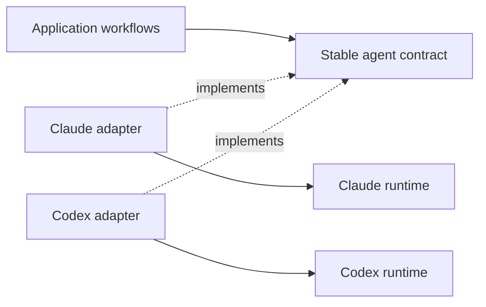

# Graph purpose and architectural judgment

**Date:** 23 October 2026

**Status:** Analysis and proposed changes

**Source baseline:** `843f4c8015560f483dd76ddd4f4d447a4daaa0a2`

**Maintainer direction:** [Complete feedback and original wording](feedback/2026-10-23-architecture-and-storage.md)

**Subsequent design review:** [Semantic graph, measured storage and current/proposed trade-offs](design/semantic-graph-redesign-2026-10-23.md).
The proposal supplies the read-only live-storage measurements requested below. Implementation is
paused by the maintainer; this earlier code audit and prompt research remain analysis, not a claim
that the new workflows are implemented.

AnaxiGraph should provide a compact, navigable graph of code and contracts that helps developers
understand behavior, predict the consequences of changes and discover worthwhile improvements.
Patterns uses that understanding to evaluate the entire pattern catalogue. Fresh Eyes receives
implementation-free descriptions of purpose and functionality and develops alternative designs.
A completed seven-hour workflow, a large description inventory and a cache below a ceiling do not
establish those outcomes.

The code audit identifies restrictions in candidate discovery, available evidence, alternative
comparison and evaluation. These are concrete reasons to investigate the harness before attributing
the reported failures entirely to a model's ability to apply knowledge. The proposed changes below
need measured evaluation on known misses and healthy controls.

## Clarified workflow requirements

The maintainer corrected two interpretations in the initial analysis. Fresh Eyes being blind to
source is a defining requirement, not an evidence defect. Using a catalogue is the intended design
of Patterns, and a useful abstraction does not require a bug or concrete failure first.

### Fresh Eyes works from purpose at multiple levels

Fresh Eyes must never inspect raw source, implementation details or the existing architectural
topology. Functional dependencies, observable inputs/outputs and externally required contracts can
describe what a system must achieve without exposing how the current implementation achieves it.
Mapping may inspect source to produce those descriptions; the Fresh Eyes worker receives only the
sanitized functional brief in a fresh context with no repository/source access. Every Fresh Eyes
proposal, critic and comparison pass observes this same boundary.

For Flowthink, the maintainer gives this top-level purpose: be a second brain connecting people's
files and folders with tools such as email, Google Drive, Shopify and other MCP servers, and make
that information and those tools available to agentic workflows. Mapping should be able to derive
and present a similarly clear statement of purpose, rather than only a list of implementation files.

| Level | Input to Fresh Eyes | Expected result |
| --- | --- | --- |
| Product purpose | The promise to users, observable capabilities and hard requirements. | Three strong, materially different ways to deliver the overall promise. |
| Capability area | What connected information/tools or agentic workflows must accomplish. | Alternative designs for that functional area, consistent with stated product requirements. |
| Functional subsystem or module | Its responsibilities, inputs, outputs and behavioral constraints, including frontend/backend functions where useful. | Three useful ways to implement that functionality without seeing its current code or internal layout. |

Three retained alternatives per reviewed level are the primary example; exploring five sketches
is also supported by the maintainer's direction. These numbers serve useful diversity, not a demand
for decorative options. Keep the alternatives and their trade-offs visible instead of collapsing
them into one reference design. Lower-level exploration can use constraints from a proposed parent
design, but cannot inherit the current implementation's topology through the brief.

Comparison with actual code, migration effort and implementation validation belong in a separate
source-aware planning or review step outside Fresh Eyes. Current architecture must not be smuggled
back into Fresh Eyes as an anonymous candidate. No-source payloads alone are insufficient if a
worker has already read the repository or can fetch it through tools.

### Patterns evaluates the entire catalogue

The shared agent/provider interface is one example among many useful patterns. It must not become
the sole search target, preferred answer or organizing assumption of the review.

For every card in the versioned catalogue, assess its potential usefulness to the reviewed
architecture and identify relevant areas. Give each pattern explicit ratings, contextual pros and
cons, supporting evidence and a recommendation. A system can work correctly while benefiting from
an abstraction, clearer ownership, a variation boundary or another pattern. Neither an existing
bug nor an already-present implementation of the pattern is required for an opportunity.

The completed assessment must account for every catalogue ID. Priority may order deeper analysis;
it must not silently omit initial consideration through top-N selection, positive-signal filters
or per-target/total candidate caps. Distinguish assessed poor fit from insufficient evidence and
unassessed work. Missing entries and unresolved evidence must remain visible in progress/results.
Report which scopes were reviewed; full catalogue coverage is not a claim to have checked every
possible combination of every pattern and every function.

Use compact shared evidence and resumable batches. Store one canonical assessment per pattern and
review scope, with short reasons and links; exhaustive catalogue consideration must not recreate
the duplicated-description storage problem.

Make this an explicit execution contract:

1. Snapshot the actual loaded catalogue fingerprint, card IDs and count, including custom cards.
2. Iterate over every card. Reuse its intent, semantic questions, benefits, liabilities and related
   patterns, then apply them to this architecture. Generic copied card text is not an assessment.
3. Save each contextual assessment once and resume missing work in bounded parallel batches.
4. Verify coverage against the expected ID set, detecting missing, duplicate or unknown IDs. Show
   pending evidence separately; a positive-signal filter must not turn an omitted card into a result.
5. Provide the full ratings/pros/cons table, with compact ranked highlights as an additional view.
   Completion and assessment coverage must not depend on a display's top-N or response-byte limit.

## The map as the primary product

The maintainer describes the map as roughly 90% of the intended product. Its core should include:

- Module and function identities, locations, LOC and function counts; public interfaces and contracts.
- Typed links for imports, calls, implementations and data ownership where supported by evidence.
  Static dependencies, observed runtime calls, inferred functional relationships and unresolved
  dynamic links must remain distinguishable.
- One short module overview, a small paragraph for important behavior, and a sentence explaining
  each function. Existing docstrings and signatures should be reused; missing semantic annotations
  can be generated in bounded batches for changed code and expanded on demand.
- Traversal from a user operation through owners, calls, state changes, callers and relevant tests.
  A readable overview should expand into focused subgraphs.
- Source fingerprints, evidence locations, confidence and explicit unknowns. A graph can be useful
  before every AI annotation is finished; structural readiness and annotation coverage are distinct.

The existing deterministic graph is the starting point. Extending it should preserve one source of
facts and one query model rather than introduce another graph database or parallel analysis product.

## What the current code actually does

These observations concern the inspected AnaxiGraph source. They do not establish which stage
failed in the cited floThink run; its actual requests, results and database need separate tracing.

| Observed behavior | Why it matters | Evidence |
| --- | --- | --- |
| Fresh Eyes defaults to two proposals and clamps the supported count to three. | Three retained alternatives fits the clarified direction. Optional five-sketch exploration would need contract support; the main requirements are diversity, hierarchy and retaining options. | [Proposal controls](../src/anaxigraph/semantic_fresh_eyes_contract.py#L27) |
| Proposal slots receive the same design instructions; different executors do not enforce different boundary or state choices. | Several proposals can converge on the same architecture with different wording. | [Proposal requests](../src/anaxigraph/semantic_fresh_eyes_requests.py#L25) |
| Adjudication produces one reference design before the current-system comparison. That comparison receives the reference, not every original alternative. | Preserve several useful alternatives at each functional level; place subsequent as-built comparison outside Fresh Eyes. | [Comparison input](../src/anaxigraph/semantic_fresh_eyes_requests.py#L102), [adjudication contract](../src/anaxigraph/semantic_fresh_eyes_contract.py#L188) |
| The existing repository-aware comparison uses up to 80 module descriptions, 30 group summaries, 30 pattern results, 120 dependency links and 40 findings; it does not include raw source. | Absence of raw source is intentional. Existing implementation topology or judgments in this packet belong to separate source-aware planning, not capability-only Fresh Eyes. | [Packet builder](../src/anaxigraph/semantic_fresh_eyes_evidence.py#L35), [module selector](../src/anaxigraph/semantic_evidence_selection.py#L121), [links](../src/anaxigraph/semantic_fresh_eyes_evidence.py#L460) |
| The final mission review receives the comparison and brief. | Fresh Eyes mission alignment should compare proposed designs against purpose and functionality without importing the existing design. | [Final review input](../src/anaxigraph/semantic_fresh_eyes_requests.py#L112) |
| Patterns starts from catalog pattern/target pairs. Its default policy allows four per target, 200 overall, minimum priority 25. Pairs without positive signals or sufficient priority are skipped before model assessment. | The catalogue is intended. The defect to investigate is incomplete opportunity coverage caused by filtering before every catalogue entry receives an assessment. | [Candidate policy](../src/anaxigraph/pattern_candidate_models.py#L18), [prefilter](../src/anaxigraph/pattern_candidate_selection.py#L101) |
| For constructive patterns, suitability at least 70 and conformance at least 80 require retain/no_action, with opportunity at most 40. | Recognize an already-good implementation while also rating opportunities where the pattern is absent. A useful introduction need not repair a bug. | [Validation](../src/anaxigraph/pattern_evaluation_contract.py#L280) |
| The pattern reviewer sees the first assessment. Parent evidence uses up to eight source witnesses and can miss important functions inside a witness file. | This is critique of a supplied hypothesis, rather than blind independent discovery. | [Assessment supplied to review](../src/anaxigraph/semantic_pattern_requests.py#L44), [witness selection](../src/anaxigraph/semantic_pattern_requests.py#L166) |
| The model-quality fixture supplies the pattern and target. Five of ten cases expect retention, one remediation, two negative and two uncertain; none are positive introduction/replacement cases. Its known_positive_misses metric counts retention cases. | That benchmark does not demonstrate end-to-end discovery of overlooked improvements. | [Benchmark](../benchmarks/architecture_judgment.py#L26), [metrics](../benchmarks/architecture_judgment.py#L106), [cases](../benchmarks/fixtures/architecture-judgment.json) |
| Graph projection is module/artifact based and excludes symbol nodes. Edge endpoints are artifacts, without first-class source/target function IDs. | Symbols are stored, but the requested function-to-function and interface-aware traversal is incomplete. | [Projection](../src/anaxigraph/persistence/graph_projection.py#L10), [node details](../src/anaxigraph/persistence/graph_node_detail.py#L33), [schema](../src/anaxigraph/persistence/temporal_schema.py#L20) |
| Any dynamic relationship can suppress dead-code analysis repository-wide. Configurable defaults also require at least 95% resolution and a known candidate last-change date older than 90 days. | No findings can mean analysis was suppressed. Disabling historical mapping makes missing age evidence an important case to test. | [Global eligibility and defaults](../src/anaxigraph/architecture_dead_code.py#L40), [candidate age](../src/anaxigraph/architecture_dead_code.py#L105) |

The deterministic foundation already includes metrics, interfaces, symbols, typed dependencies,
cycles and impact traversal with relevant tests. [Impact analysis](../src/anaxigraph/agent_impact.py#L119)
and [boundary rules](../src/anaxigraph/architecture_rules.py#L268) should support the core product.
Their existence does not yet prove behavioral isolation or executable contract preservation.

### Existing protections to retain

Supported dashboard workflows preserve the original mapping configuration while planning review
prerequisites. An existing test checks that Patterns leaves mapped module document IDs unchanged.
Standalone `patterns` reads saved results; standalone Fresh Eyes also passes the original mapping
configuration through. Do not diagnose the seven-hour run as an automatic detailed remap without
its actual configuration and job history. A deliberate `detailed_reviews: false` to `true` change
followed by generic bootstrap can invalidate file analyses because that mode participates in their
input hashes. See [workflow guard](../src/anaxigraph/workflow_execution.py#L155),
[regression test](../tests/test_workflows.py#L78), [Fresh Eyes planning](../src/anaxigraph/semantic_fresh_eyes_review.py#L117)
and [file input identity](../src/anaxigraph/semantic_module_intrinsic.py#L79).

## Storage should follow the knowledge model

The reported 4.95 MB portable record and 122 MB cache describe different representations, so their
sizes need not match. Nevertheless, fitting under the 200 MB ceiling does not establish efficiency.
Source defaults remain 64 MB for the index and 100 MB for active state; 122 MB exceeds those
defaults. The run's effective budgets and the contents of its reported cache still need measurement.
See [storage policy](../src/anaxigraph/storage_policy.py#L11).

The current baseline still generates intrinsic and contextual file documents. Their JSON is also
copied into `semantic_claims`, with supporting evidence separately stored, and selected text is
indexed for search. IR serialization already removes some derivable metadata, so this is not a
claim that every fact is completely uncompressed. See [result persistence](../src/anaxigraph/semantic_results.py#L142),
[claim schema](../src/anaxigraph/persistence/schema.py#L142), [search projection](../src/anaxigraph/persistence/search_read.py#L240)
and [IR compaction](../src/anaxigraph/ir_serialization.py#L124).

Before choosing another storage limit, collect a read-only breakdown from the actual owning index:

1. Effective storage configuration, SQLite `dbstat` bytes for each table and index, row counts,
   and JSON bytes by document kind.
2. Page count, free-page count and WAL bytes, distinguishing live data from reclaimable space.
3. Current versus retained generations, canonical documents versus copied claims, and FTS bytes.
4. Portable-record files, recovery copies, worker logs and temporary output measured separately.
5. Bytes per module, symbol and edge, plus real query/import latency. A smaller file that makes
   every query expensive is not a demonstrated improvement.

| Information | Proposed representation |
| --- | --- |
| Source-derived nodes, metrics, signatures and typed links | One canonical fact representation; rebuild locally and expand symbol views as needed. |
| Module/function descriptions and contracts | One concise canonical annotation; store contextual deltas and cross-boundary findings rather than another full essay for every file. Preserve original saved analyses through migration. |
| Claims and search | Reference canonical documents. Evaluate views and external-content/contentless FTS against current correctness and latency before replacing copies. |
| Architectural alternatives, findings and selected plans | Compact structured artifacts with exact evidence, trade-offs, provenance and verification status. |
| History and runtime state | Git history for portable results, bounded local checkpoints and logs, and explicit recovery retention. |

## Suggested prompt replacements

These are drafts for evaluation. Fresh Eyes and Patterns have different input permissions and
objectives. Their schemas, isolation, catalogue coverage, freshness versions and sequencing must
support these explicit instructions.

### Fresh Eyes exploration

```text
Use only the supplied purpose, functionality, observable inputs/outputs and hard constraints.
Never inspect source code, the current architecture, implementation-specific dependencies or
previous implementation judgments. Do not request or retrieve them through tools or context.
At the product level, state the promise being delivered and propose three strong alternatives.
Then repeat for each reviewed capability area and functional subsystem: what must it accomplish,
and what are three materially different ways to implement that functionality?
You may explore five sketches before retaining three. Vary responsibility/state ownership,
control flow or integration boundaries; renaming boxes does not create another design.
For each retained option give a small proposed graph, functional fit, pros, cons, assumptions,
failure scenarios and the conditions under which it wins. Keep the alternatives distinct.
Compare them against the same functional requirements. Do not collapse them into one design.
State a genuine lack of viable alternatives rather than fabricate diversity.
```

Generate concise hierarchical sketches. Every pass remains implementation-blind. Compare proposed
alternatives with each other using the same capability scenarios, retaining trade-offs and useful
disagreements. A separate planning step can later compare them with the actual implementation.

### Evaluate every pattern explicitly

```text
Evaluate EVERY entry in the supplied versioned pattern catalogue. Do not select a small subset,
stop after a few findings, or discard patterns because the code currently works or lacks a smell.
Use the map, functionality, interfaces and source evidence to consider where EACH pattern could
help, including patterns not yet implemented. Do not anchor on one example or pattern family.
For EVERY catalogue ID return:
1. Intent and relevant areas/roles; where the pattern could apply in this architecture.
2. Current presence/conformance, separate from potential usefulness.
3. Suitability and improvement-opportunity ratings with evidence and confidence.
4. Concrete contextual pros and cons, including added complexity, costs and risks.
5. A recommendation valid for the card kind, such as introduce/retain or remediate. Keep missing
   evidence and review status separate from the recommendation rather than invent wire enums.
6. A representative change/use scenario showing why the recommendation would help or not help.
A beneficial abstraction does not require a bug. Check shared behavior, variation points,
ownership, interfaces, coordination, state and other forces described by each catalogue card.
Apply constructive-pattern and failure-mode cards according to their respective meanings.
Patterns may complement one another. Finding one useful pattern is not a reason to stop reviewing
the remaining catalogue entries; use the catalogue's alternative/complementary relationships.
For poor fits give the reason; for missing evidence state what must be investigated.
Account for every catalogue ID and show assessed/total. Missing or unresolved assessments must
remain visible; do not call silently omitted or unassessed patterns unsuitable or complete.
Before declaring completion, reconcile the returned ID set with the loaded catalogue; repair
missing/duplicate assessments and resume pending work. Provide the complete assessment table.
```

This requires complete catalogue accounting before prioritizing deeper investigation. Candidate
selection can schedule work and suggest relevant areas, but cannot silently remove catalogue IDs.
Use a coverage table keyed by catalogue version, pattern ID and declared review scope. The table
must include contextual ratings, pros, cons, rationale, evidence and review status for every entry.
An unsuitable assessment is a reviewed outcome; an unassessed entry is unfinished work.

### Strong critic with a falsification task

```text
Construct the strongest defensible criticism of each important boundary, including each proposed
alternative. Describe the concrete mechanism, affected callers, and a scenario where it matters.
For Fresh Eyes use only the functional brief, proposed designs and hypothetical behavior/failure
scenarios. Never inspect the actual implementation. For Patterns, source and test evidence may
support or refute an opportunity. Give the strongest counterargument to each recommendation.
Do not require a minimum defect count, a preexisting failure, or agreement with the first reviewer.
Return the few findings with the strongest evidence and the most useful next experiments.
```

A reviewer can independently assess the same permitted inputs before seeing a first assessment.
Fresh Eyes remains capability-only throughout; Patterns may inspect mapped/source evidence.
Record which prior conclusions each reviewer could see. Highlighting the strongest findings must
not hide the complete per-pattern assessment table.

### Compare alternatives through changes and failures

```text
Within Fresh Eyes, compare every retained proposed design against the same purpose, functionality,
growth, change and failure scenarios. Explain functional fit, contract choices, pros, cons and
uncertainty without seeing the existing implementation. Preserve the three useful alternatives.
Outside Fresh Eyes, source-aware planning may compare those proposals with the current system,
estimate migration effort and choose reversible implementation experiments. Keep measured results
separate from expected benefits and do not feed implementation details into Fresh Eyes.
```

## The agent interface as a robustness example

This is one of many potential catalogue opportunities, not the preferred answer to every review.
The maintainer's experience is that several reviews failed to suggest a common agent abstraction
when integrating multiple LLM providers, although it made the tool easier to structure. The example
does not require a bug: the benefit is a stable contract for callers and provider-specific variation
behind that contract. Detection should recognize the role structure without being handed a pattern
name or requiring one exact class name, language mechanism or catalogue label.

The following illustrates that boundary; it is not a discovered floThink diagram.
Solid arrows mean uses; dashed arrows mean implements.



Use representative changes—provider SDK response shape, cancellation, streaming, errors and
capability differences—to ask which modules should change and which should remain unaffected.
Run the same caller-facing contract checks against both adapters; verify differences exposed by
the contract rather than promise identical provider behavior. Compare predicted and actual edit
scope, tests and behavior. Static boundary rules support this investigation; executed tests establish
behavioral evidence. An intentional shared-contract change has a different expected impact from an
internal adapter change.

For dead-code work, report known entry points, dynamic registrations and unresolved reachability per
candidate. Treat age and missing history as evidence about confidence, and surface young or
unversioned candidates explicitly. Preserve the maintainer's willingness to delete and revert:
propose a scoped removal, focused startup/behavior checks and a Git rollback point. A disconnected static node is useful
evidence for an experiment, while repository-wide silence caused by a suppression rule is not a
clean bill of health.

## Research agenda for applying knowledge

Test five abilities separately: explaining a principle, finding relevant permitted evidence,
recognizing a useful pattern opportunity, constructing a feasible alternative, and selecting the
better alternative. Opportunity recognition includes beneficial changes to working code.
This separates a model knowledge problem from retrieval, search or adjudication failure.

Begin with 12–20 cases containing beneficial pattern opportunities in working code, confirmed
defects and healthy near-misses. This pilot case count does not limit production catalogue coverage.
Include held-out real
before/after changes and carefully seeded faults, validated by tests and knowledgeable reviewers:
the shared-agent abstraction as one positive example, provider details leaking through an adapter,
other catalogue families and scope levels, an unused function versus a registered plugin,
conflicting mutable state versus a legitimate cache, excessive propagation versus an intentional
interface change, and an overconnected responsibility cluster versus a useful orchestration hub.

| Experiment | Hold constant | What it distinguishes |
| --- | --- | --- |
| Principle recall versus useful opportunity recognition | The architectural principle and permitted facts | Whether a known pattern is applied where it helps, even without a defect. |
| Catalogue-wide assessment versus the current prefiltered candidate path | Catalogue, repository revision, model and total budget | Missed useful patterns, explicit coverage and false recommendations across many pattern families. |
| Neutral versus strong-critic instructions for Patterns, with mapped versus targeted source evidence | Model, revision, tasks and total budget | Wording effects versus evidence availability; Fresh Eyes never receives source in either condition. |
| Hierarchical Fresh Eyes with three retained alternatives, optionally explored from five sketches | Functional brief, total budget and implementation blindness | Diversity and quality at product, capability and subsystem levels. |
| Critique with additional functional scenarios for Fresh Eyes; directed source/test investigation for Patterns | Initial permitted evidence and budget | Correction within each workflow's information boundary. |
| Compact versus verbose functional briefs for Fresh Eyes; graph annotations for Patterns | Workflow-specific access rules and task budget | Usefulness per token/byte without contaminating Fresh Eyes with implementation. |
| Renamed roles, distracting details and unfamiliar combinations of known principles | The actual opportunity and required behavior | Dependence on surface cues versus transfer. |

Measure useful-opportunity recall across catalogue families, explicit catalogue coverage, finding
precision, healthy-design false alarms, permitted-evidence correctness,
feasible alternatives, behavioral contract preservation, unnecessary edit scope, time to first
verified finding, model usage and storage. Record whether a good alternative was generated and
whether the comparator selected it separately. Different graphs indicate diversity, not quality.
For source-aware Patterns evaluation, retain healthy designs as controls. For Fresh Eyes, evaluate
functional fit without revealing the actual implementation. Do not reward criticism count or make
the shared-agent example the only positive case.

Run a bounded manual pilot before another whole-repository review. User direction can remain blank;
defaults should choose useful scenarios from the functional brief for Fresh Eyes and mapped code
for Patterns. Model choice and a paid-run
budget must be explicit before live experiments. This proposal adds no paid model work to CI or
pre-push checks. Existing fixture tests establish mechanics, not live architectural judgment.

### Research supporting the experiments

- [Huan et al. 2026, Does Math Reasoning Improve General LLM Capabilities](https://proceedings.mlr.press/v306/huan26a.html): experiments across more than 20 open-weight reasoning-tuned models found that math gains often did not transfer to other domains. This motivates measuring architectural application directly, not extrapolating from unrelated leaderboards.
- [Kong et al. 2026, From Reasoning Traces to Reusable Modules](https://proceedings.mlr.press/v306/kong26c.html): controlled work on recombining learned reasoning skills motivates tests using unfamiliar combinations of known principles. Their modules are reasoning operations, not software components.
- [GSM-Symbolic 2024](https://arxiv.org/abs/2410.05229): controlled mathematical variations and irrelevant information affected the tested models. This motivates surface-variation controls, not a universal claim about software reasoning.
- [Huang et al. 2023, Large Language Models Cannot Self-Correct Reasoning Yet](https://arxiv.org/abs/2310.01798): intrinsic revision without new external feedback was unreliable in the studied settings. [SCoRe 2024](https://arxiv.org/abs/2409.12917) provides counterbalancing evidence that multi-turn reinforcement learning can improve self-correction on tested math/coding tasks. Neither result settles present-day architecture review.
- [Towards Understanding Sycophancy 2023](https://arxiv.org/abs/2310.13548): tested judgments could follow user beliefs. Healthy controls are important when prompting a model to attack an existing design; stronger agreement with a critic is not stronger evidence.
- [Large Language Monkeys 2024](https://arxiv.org/abs/2407.21787): repeated sampling improved candidate coverage, while selection remained difficult without good verification. Evaluate generation and selection independently.
- [SWE-bench 2023](https://arxiv.org/abs/2310.06770): executable repository-level issue evaluation motivates behavior-based tests. Issue repair is not itself an architectural-quality benchmark.
- [ArchBench 2026](https://arxiv.org/abs/2603.17833): architecture evaluation infrastructure covers generation and traceability tasks, while its paper identifies smell detection, dependency analysis and large refactoring planning as gaps. It does not supply a ready-made evaluation of AnaxiGraph's discovery task.

These studies motivate falsifiable experiments. They do not establish that all current models lack
reasoning or that humans always transfer knowledge better. Training research can follow a dataset
of verified successes, failed applications and misleading near-misses after harness experiments.

## Investigation and implementation checklist

- [x] Preserve the full maintainer feedback, reported run figures and adapter example.
- [x] Audit the graph, description storage, review inputs, candidate gates and evaluation fixture.
- [x] Draft prompts, harness changes and a research agenda with primary sources.
- [x] Capture the clarified Fresh Eyes blindness/hierarchy and exhaustive catalogue requirement.
- [x] Record the shared-agent abstraction as one positive opportunity, not an exclusive search target.
- [ ] Build positive opportunity cases across many catalogue families, including the supplied agent
  example without a pattern-name hint. Trace discovery, assessment, review and presentation.
- [ ] Measure the actual owning cache by table/index, generation, copied JSON, FTS, free pages,
  WAL, portable files, recovery copies and logs. Keep reported numbers separate from measurements.
- [ ] Specify graph readiness, annotation coverage and analysis coverage as different product states.
- [ ] Design module/function/interface traversal with evidence and localized uncertainty.
- [ ] Specify one canonical concise annotation and the reuse/migration path for existing paid results.
- [ ] Remove redundant JSON copies where measured benefit and query correctness justify it.
- [ ] Expose unassessed/suppressed dead-code checks and replace global suppression with scoped evidence.
- [ ] Evaluate every catalogue entry with contextual ratings, pros, cons, rationale and coverage;
  use prioritization for deeper work without silently dropping initial assessments.
- [ ] Produce purpose/capability briefs at product, area and subsystem levels with implementation
  details removed, and enforce source-free Fresh Eyes workers and contexts.
- [ ] Retain three strong Fresh Eyes alternatives per reviewed functional level, optionally exploring
  five sketches, and keep source-aware comparison/migration outside Fresh Eyes.
- [ ] Add known beneficial changes, healthy near-misses and held-out cases to discovery evaluation.
- [ ] Run the bounded pilot and publish measured quality, latency, model usage and storage outcomes.
- [ ] Use those results to choose production changes and acceptance criteria.

This checklist records proposed work. This documentation change does not alter runtime prompts,
review behavior or storage, and no new live model-quality result is claimed.
