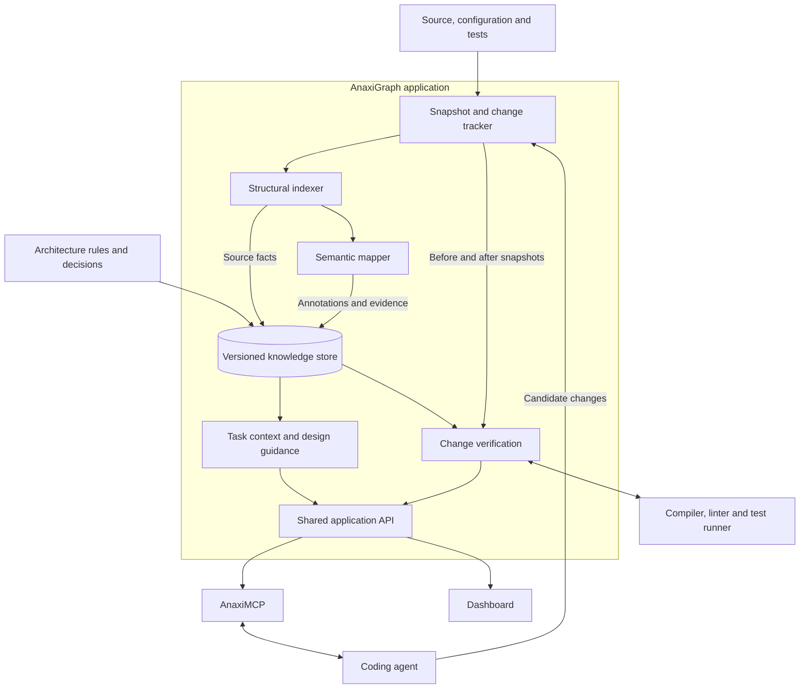

# Provided proposal for building AnaxiGraph from scratch

**Received:** 24 October 2026

The maintainer supplied the following complete proposal from a separate ChatGPT conversation and
requested preservation, comparison with the 0.9.2 plan, a bottom-up code estimate, and a decision
framework for whether to start again. The proposal below is retained as supplied. External project
statistics and research claims are the original author's claims, not new AnaxiGraph measurements.

## Original proposal

**I would build AnaxiGraph around the process of making and checking code changes, with the semantic graph supplying the evidence for those decisions.**

Concretely, I would start with **one application, one database, language adapters, a background annotation worker, and a shared API used by coding agents, the dashboard, and CI**.

The central design question would be:

> Given this requested change, what existing responsibility should own it, what contracts must remain true, and what is the simplest implementation that will leave subsequent changes straightforward?

Your description already contains several useful foundations: structural parsing, concise explanations, progressive exploration, provenance, and a shared understanding for humans and agents. I would connect those foundations directly to **design decisions before editing and verification after editing**.

This is a proposal based on the description you supplied. I have not looked up AnaxiGraph, AnaxiMCP, or their implementation. The external references below concern specific techniques and research.

## 1. Start by defining what “better code” means

I would make the system optimise for four outcomes:

1. **Correct behaviour:** the change meets its requirements and preserves existing guarantees.
2. **Clear responsibility:** functionality lives in an appropriate place, with understandable ownership.
3. **Low unnecessary complexity:** the change introduces as few additional concepts, dependencies, and special cases as reasonably possible.
4. **Ease of subsequent change:** someone can extend, debug, or remove the functionality without having to understand half the repository.

This affects how you treat patterns. A Strategy pattern, an interface, or an extra service layer should appear because it solves a concrete problem. Sometimes the best architectural recommendation will be:

> “Use this existing function. Add one parameter. Keep the new transformation local.”

Other times it will be:

> “This module already owns three unrelated responsibilities. A small extraction here will make this change and the next one substantially easier.”

Both can be good outcomes.

I would therefore avoid making line count, number of abstractions, or dependency count the overriding objective. Removing necessary validation reduces lines while weakening the system. A well-placed interface can add code while reducing the amount a developer must understand.

**The objective is less unnecessary complexity, subject to correct behaviour and the project’s actual requirements.**

## 2. The high-level architecture

Here is the architecture I would start with. These boxes represent logical modules; most would run inside the same application.



The important responsibilities are:

| Component | Responsibility |
|---|---|
| **Snapshot and change tracker** | Establish exactly which repository state is being analysed, including uncommitted changes. |
| **Structural indexer** | Extract modules, symbols, interfaces, references, dependencies, and other mechanically discoverable information. |
| **Semantic mapper** | Explain purpose, responsibility, relevant behaviour, and uncertainty using evidence from the indexed source. |
| **Knowledge store** | Keep these records associated with their source revision and provenance. |
| **Task context and design guidance** | Turn a requested change into relevant ownership, reuse opportunities, contracts, examples, and design options. |
| **Change verification** | Compare the original and modified code, evaluate architectural rules, and collect executable validation results. |

### I would choose a modular monolith

My starting deployment would be a repository-local service, with a CLI and MCP interface. The dashboard would use the same application API.

For that version, I would choose **SQLite with full-text search**, using ordinary tables for entities, relationships, annotations, and findings. If shared server operation with concurrent writers were a requirement from the beginning, I would choose PostgreSQL instead. I would implement one deployment model first.

A graph-shaped data model does not require a dedicated graph database. Initially, I would implement the actual queries—callers, consumers, dependency paths, affected contracts—using indexed relationships and bounded traversals. A specialised graph database would become a decision driven by measured query requirements.

The database would hold a **derived understanding of the repository**. Source code, explicit contracts, and accepted architectural decisions would remain authoritative.

That makes the system recoverable: indexes can be rebuilt, annotations can be refreshed, and a mistaken inference does not become an independent source of architectural truth.

## 3. Keep facts, interpretations, obligations, and proposals distinct

This is one of the most important decisions in the design.

A statement such as “module A imports module B” has a different status from “module A should own payment orchestration.”

I would represent four categories explicitly:

| Category | Example | Treatment |
|---|---|---|
| **Observed source information** | `InvoiceService` references `InvoiceRepository`. | Record the extraction method, resolution status, and source location. |
| **Inferred meaning** | “This module appears to coordinate invoice creation.” | Keep supporting evidence and allow correction. |
| **Accepted architectural intent** | “Invoice persistence must be accessed through the billing module’s public interface.” | Store as a versioned project rule or decision. |
| **Proposed design** | “Move invoice formatting into a separate adapter.” | Keep as a proposal until implemented or accepted. |

The distinction must exist in the data model and API responses. A coloured badge in the dashboard would be insufficient.

Otherwise, the system risks learning the current architecture—including its mistakes—and repeatedly recommending that agents reproduce it.

### Use a small graph vocabulary

I would begin with a limited set of entities:

- **Modules:** meaningful responsibility boundaries.
- **Symbols:** functions, classes, types, and interfaces.
- **Contracts:** public schemas, behavioural obligations, and compatibility requirements.
- **Capabilities:** what functionality the repository provides.
- **Resources:** database tables, queues, events, external APIs, and relevant configuration.
- **Tests:** executable evidence associated with behaviour or structure.

Relationships could include `contains`, `imports`, `references`, `implements`, `consumes`, `produces`, `reads`, and `writes`.

Semantic relationships such as “owns this capability” would carry their own status: inferred, explicitly declared, or accepted.

I would also distinguish an architectural module from a source file. Sometimes a file is a meaningful module; sometimes the boundary is a package or a small directory. Treating every file as an independent architectural unit can obscure responsibility.

### Parsing is the first layer of understanding

Tree-sitter is a useful precedent for obtaining syntax quickly: it builds syntax trees incrementally and is designed to remain useful while source contains syntax errors. [Tree-sitter](https://tree-sitter.github.io/tree-sitter/?utm_source=chatgpt.com)

But a syntactic call expression is not necessarily a uniquely resolved call target.

I would use language-specific compiler or analysis facilities where available, and represent the difference between:

- A reference observed in syntax.
- A target resolved by a language analyser.
- Several possible targets.
- A relationship inferred by a model.
- A relationship observed during a particular execution.
- An unresolved relationship.

This matters for impact analysis. “No callers were found in the analysed scope” is useful information. It is not a guarantee that a function has no consumers.

### Contracts need to describe behaviour

A function signature alone is a weak description of an interface.

For example:

```typescript
createInvoice(input: InvoiceInput): Promise<Invoice>
```

does not explain whether the operation:

- Is idempotent.
- Requires an authenticated tenant.
- Writes several records atomically.
- Emits an event.
- Distinguishes retryable failures from permanent failures.

Those are architectural obligations that agents need when they change callers or implementations.

Some can come from explicit schemas, documentation, or tests. Others will initially be inferred. The system should retain that distinction and should never equate “a test references this function” with “this test verifies all its guarantees.”

## 4. Make semantic mapping compact, incremental, and correctable

I agree with the direction of **one compact annotation per module**.

I would structure that annotation around decisions an agent needs to make:

| Field | What it should communicate |
|---|---|
| **Overview sentence** | The module’s purpose. |
| **Short explanation** | Its responsibility and how it fits into the system. |
| **Public surface** | The important interfaces and entry points, referenced from the structural index. |
| **Behavioural notes** | Relevant invariants, side effects, and failure behaviour. |
| **Key implementation notes** | Selected function summaries and local conventions. |
| **Evidence references** | Source locations, schemas, tests, and decisions supporting the claims. |
| **Uncertainty** | What remains inferred, unresolved, or incompletely analysed. |

The sentence, paragraph, and function-level expansion would be different views of the same saved record. I would avoid independently generated descriptions that can drift apart.

Most mechanical detail should be referenced rather than rewritten. The parser already knows a function’s parameters; the mapper should explain why the function exists and what a caller needs to understand.

### Refresh according to dependencies

“Re-map changed files” is a useful starting point, but the invalidation logic needs to go further.

Suppose module A calls module B. B changes a return contract. A’s source remains unchanged, but the explanation of A may now be inaccurate.

I would make each annotation depend on:

- The relevant source content.
- The contracts and interfaces it used as evidence.
- Relevant configuration and architectural rules.
- The annotation schema and extraction versions.

When an input changes, the system marks affected interpretations stale and refreshes them selectively.

The normal sequence would be:

1. Capture the changed repository state.
2. Update structural information.
3. Invalidate affected interpretations.
4. Make fresh structural results available.
5. Refresh semantic annotations in the background.

An older mapping job must never overwrite a newer result. Publication should check that the job’s input revision is still the intended one.

### Handle multiple agents from the beginning

A commit hash is insufficient when agents are editing separate worktrees.

Every query should identify its repository state using the base revision plus the relevant working-tree contents and analysis configuration. Each agent should see its own changes.

I would use a shared immutable base index with worktree-specific changes layered over it. That avoids copying the entire index while keeping agents’ interpretations separate.

Before validating a patch against a different base, the system should recompute the affected analysis.

### Let people correct the understanding

A wrong persistent summary can mislead many future changes.

Users should be able to correct responsibility ownership, reject an inferred relationship, or identify a preferred implementation example. Those corrections should survive reindexing as explicit project knowledge.

They should also remain distinguishable from source-derived observations. If the code contradicts an accepted architectural statement, that contradiction is something to surface.

## 5. Make the agent interface answer change-related questions

I would make AnaxiMCP’s everyday interface small and oriented around the agent’s task.

| Operation | Purpose |
|---|---|
| **`prepare_change(task, snapshot)`** | Find relevant ownership, existing capabilities, contracts, examples, affected areas, and verification requirements. |
| **`inspect(entity, snapshot)`** | Expand a module, symbol, contract, or dependency path with current source evidence. |
| **`assess_plan(plan, snapshot)`** | Identify questionable placement, unnecessary abstractions, missing reuse opportunities, and contract risks before a substantial edit. |
| **`validate_change(base, candidate)`** | Compare the code states and return structural findings, behavioural checks, and unresolved concerns. |

The output of `prepare_change` would be a compact change brief. For example:

> **Likely owner:** billing application module.
> **Existing capability:** invoice retrieval already supports the required filtering.
> **Use:** the public invoice query interface.
> **Preserve:** tenant isolation and currency rounding.
> **Relevant example:** the existing statement export.
> **Likely impact:** export route, formatter, and invoice export tests.
> **Uncertainty:** whether historical invoices require a separate permission.

That gives the agent specific material to act on.

### Combine retrieval methods

I would combine exact symbol lookup, lexical search, capability search, and targeted graph traversal.

The graph is particularly useful for moving from an initial match to:

- Its consumers.
- The contract it implements.
- The resource it modifies.
- The tests associated with its behaviour.
- The rule governing its dependency boundary.

Semantic retrieval can help find a capability whose name differs from the user’s wording. It should complement precise lookup.

Context selection needs a budget. Aider’s repository map is a useful precedent: it ranks relevant repository information and selects material that fits the available context. [aider](https://aider.chat/docs/repomap.html?utm_source=chatgpt.com)

Research also supports being selective. In RepoGraph’s reported ablation, flattened one-hop context achieved a 29.67% resolution rate, while flattened two-hop context achieved 26.00%. That particular experiment does not establish a universal retrieval depth, but it demonstrates that supplying more graph context can make performance worse. [arxiv.org](https://arxiv.org/html/2410.14684v2?utm_source=chatgpt.com)

I would therefore support progressive expansion, while always including directly applicable obligations. A relevant architectural restriction should not disappear merely because it ranked below several popular utility functions.

### Ensure agents actually use it

Providing MCP tools does not ensure they influence the coding process.

I would integrate the system into the agent’s existing workflow:

- Prepare context when a task begins.
- Reassess when the scope changes substantially.
- Validate the candidate before the task is reported complete.

Minor edits should remain lightweight. A spelling correction does not need an architectural planning exercise.

For a substantial change, the brief should contain enough evidence for the agent to inspect the important current source before editing it. Saved understanding should reduce repeated exploration while preserving access to implementation detail.

## 6. Teach pattern selection through concrete situations

I would give this particular attention because it connects directly to your objective.

A model may know what dependency inversion, Strategy, or composition means and still fail to recognise when one would improve the code in front of it.

The system therefore needs to help with **identifying the relevant design problem**.

CodeTaste explicitly separates carrying out instructed refactorings from discovering refactorings independently. Its results show a substantial gap between those capabilities. It evaluates both behaviour preservation and structural changes, although agreement with historical human refactorings does not capture every valid alternative design. [arxiv.org](https://arxiv.org/html/2603.04177v2?utm_source=chatgpt.com)

My engineering inference is that pattern guidance should contain:

1. **A concrete trigger:** what situation makes this approach useful?
2. **The problem addressed:** what coupling, duplication, or change pressure would it reduce?
3. **The simplest viable alternative.**
4. **Conditions where it adds unnecessary complexity.**
5. **A preferred local example**, when one exists.
6. **Checks that would demonstrate the intended improvement.**

For example:

| Situation | Guidance |
|---|---|
| Several callers implement the same business rule | Investigate a shared owner for that rule; compare the behaviour before consolidating it. |
| An external API’s details leak through several modules | Consider an adapter that contains those details behind the application’s own contract. |
| Several algorithms genuinely need independent substitution | Consider a strategy boundary; account for the added interface and configuration burden. |
| Two blocks look similar but represent different business concepts | Preserve separate ownership unless there is evidence that they should evolve together. |

The pattern library should be small and curated initially.

It also needs to distinguish **preferred examples**, **ordinary existing code**, and **legacy code being replaced**. Frequency alone is a poor basis for selecting architectural examples.

For each meaningful design proposal, I would require a short explanation of the actual benefit:

> “This moves provider-specific error handling behind the existing transport interface, so callers no longer need to know the provider’s exception types.”

That is actionable. “Apply clean architecture” is much harder to verify.

## 7. Verify the architectural effect of the patch

The verification module is what connects the saved understanding to measurable code quality.

I would compare the original and candidate states and produce three classes of result.

### A. Behavioural validation

Collect results from the project’s existing tools:

- Compilation and type checking.
- Relevant tests.
- Required regression suites.
- Contract or integration checks.
- Linting and other established checks.

The graph can help select targeted tests, but incomplete graph coverage must not silently remove required validation.

### B. Mechanically checkable architectural rules

Examples include:

- A domain module imports a persistence implementation across a prohibited boundary.
- A module accesses another module’s private implementation.
- A new dependency cycle appears in a scope where cycles are prohibited.
- A deprecated component gains a new consumer.
- A public interface changes without the required compatibility checks.
- A patch introduces an unused dependency.

These rules should live with the repository and evolve through the normal code review process.

ArchUnit demonstrates the principle of expressing architectural constraints as executable tests. Its “freezing” mechanism also provides a useful adoption model: record existing violations, then report new ones while reducing the baseline as old violations are fixed. [archunit.org](https://www.archunit.org/userguide/html/000_Index.html?utm_source=chatgpt.com)

I would borrow that approach. Existing architectural debt should remain visible, while ordinary changes can be checked for additional deterioration.

### C. Design concerns requiring judgement

Examples include:

- A module may be acquiring an unrelated responsibility.
- New code appears to duplicate an existing capability.
- A proposed abstraction has no clear use beyond its first caller.
- A local change expands the public API unnecessarily.
- A refactoring removes a useful separation between independently changing concepts.

These findings should include evidence and practical alternatives. They should remain distinct from established rule violations.

A useful finding would say:

> This patch introduces a direct dependency from the export route to the invoice storage implementation. Rule `billing-public-api` requires access through the billing interface. The existing `listInvoices` operation provides the required data and applies tenant filtering.

Every result should distinguish **passed within the analysed scope**, **violated**, and **unresolved**. Missing analysis is not a successful check.

### Make deletion a supported workflow

Your emphasis on dead code should be reflected explicitly.

I would identify removal candidates using reachability from configured entry points, public package exports, framework registration, configuration, and other known consumers.

Knip is a useful precedent: it builds a graph from entry files and identifies unused files, exports, and dependencies. Its documentation also explains how missing entry points, dynamic imports, generated files, or incomplete framework support can affect findings. [Knip](https://knip.dev/explanations/how-knip-works?utm_source=chatgpt.com)

AnaxiGraph should therefore produce findings such as:

> This function has no references in the analysed application and is not part of the declared public API. The plugin loader remains unresolved, so check that registration before removing it.

It should help the agent investigate, remove, and verify unnecessary code. A low incoming-edge count alone would not justify deletion.

## 8. A concrete example of the complete workflow

Suppose the task is:

> “Add a CSV export of invoices.”

I would want AnaxiGraph to influence the change as follows.

**First, establish ownership.** It identifies invoice retrieval as a billing responsibility and CSV formatting as a presentation concern.

**Second, find reuse.** It finds an existing invoice query operation that already handles filters, permissions, and calculated totals.

**Third, supply the relevant contracts.** It highlights tenant isolation, date filtering, monetary formatting, and any export-specific requirements.

**Fourth, guide the smallest suitable design.** If this is the only export format, it might recommend a straightforward CSV formatter behind the existing route. The recommendation would explain whether an additional abstraction has any present benefit.

**Fifth, inspect the candidate.** If the agent writes a separate database query and recalculates invoice totals, AnaxiGraph can flag the bypassed boundary and possible duplicated responsibility. If the agent reuses the existing query, it can focus validation on filtering, authorisation, and serialization.

**Finally, refresh the understanding.** The export becomes discoverable through the capability index, with links to its implementation, contracts, and tests.

The useful outcome is concrete: the agent avoided duplicating billing behaviour, preserved existing guarantees, and added a small feature in an understandable place.

## 9. Keep the dashboard focused on decisions

I would make the dashboard answer a few practical questions:

- Where does this responsibility live?
- What can call this interface?
- What assumptions does it impose?
- What changes when this patch lands?
- Which findings require attention?
- Which parts of the saved understanding are uncertain?

The graph would be an expandable view around the selected module, contract, or change.

The default module page could show the overview sentence, short explanation, public contracts, important consumers, and relevant tests. The default change page could show new dependency edges, modified contracts, rule violations, and removal candidates.

I would also make evidence and correction easy to access. If someone disagrees with “this module owns authentication,” they should be able to inspect why the system believes it and correct the interpretation.

For the implementation itself, I would enforce straightforward boundaries:

- Parsers produce structured observations.
- Mappers produce annotations and claims.
- Query logic assembles context.
- Verification produces findings.
- MCP and the dashboard render those results.

Neither the dashboard nor MCP should contain its own separate architectural reasoning. Both should expose the same answers.

## 10. Established projects I would borrow from

These projects all exceed the 1,000-star threshold you suggested. Counts are approximate figures displayed on the GitHub pages checked for this answer.

| Project | Approximate stars | What I would borrow |
|---|---:|---|
| [Aider](https://github.com/Aider-AI/aider) | 49.7k | Compact repository context selected for the current task and token budget. [GitHub](https://github.com/Aider-AI/aider?utm_source=chatgpt.com) |
| [Tree-sitter](https://github.com/tree-sitter/tree-sitter) | 27.3k | Incremental syntax extraction and useful results during editing. [GitHub](https://github.com/tree-sitter/tree-sitter?utm_source=chatgpt.com) |
| [ArchUnit](https://github.com/TNG/ArchUnit) | 3.9k | Executable architecture rules and gradual adoption through recorded violation baselines. [GitHub](https://github.com/TNG/ArchUnit?utm_source=chatgpt.com) |
| [dependency-cruiser](https://github.com/sverweij/dependency-cruiser) | 7.3k | Explicit allowed, forbidden, and required dependency relationships with actionable findings. [GitHub](https://github.com/sverweij/dependency-cruiser?utm_source=chatgpt.com) |
| [Knip](https://github.com/webpro-nl/knip) | 12.5k | Entry-point-based analysis of unused files, exports, and dependencies. [GitHub](https://github.com/webpro-nl/knip?utm_source=chatgpt.com) |

I would reuse mature analysis tools where they fit the repository’s language. AnaxiGraph’s distinctive work would be combining their evidence with responsibility, architectural intent, and the agent’s requested change.

## 11. Prove that it improves subsequent code changes

I would design the evaluation before expanding the platform.

A reasonable first experiment would compare four configurations:

| Configuration | Agent support |
|---|---|
| **A** | Normal source inspection, search, compiler, and tests. |
| **B** | A plus a compact structural repository map. |
| **C** | B plus semantic annotations and task-specific change briefs. |
| **D** | C plus architectural rules, plan assessment, and patch feedback. |

Use the same starting revisions, tasks, models, and comparable resource budgets. Repeat enough tasks to avoid drawing conclusions from a few fortunate runs. Include indexing, annotation, and refresh costs in the accounting.

The measurements should include:

- Functional success and regressions.
- New architectural violations.
- Unnecessary duplication and abstractions, assessed against an explicit review rubric.
- Public API expansion and compatibility.
- Removal of genuinely unnecessary code.
- Human review effort.
- Total time and cost.
- Success on a subsequent change to the resulting code.

That last measurement is especially important.

CodeThread evaluates downstream work through two-step task chains. Its authors found that traditional complexity and verbosity metrics did not fully explain differences in subsequent task success; behavioural details such as validation and error handling were clearer signals. Its findings are bounded to the studied settings and two-step chains, but the evaluation approach is highly relevant here. [arxiv.org](https://arxiv.org/html/2606.21804v1?utm_source=chatgpt.com)

For your system, I would ask an agent to implement feature A, then give a fresh agent feature B that builds on it. Later, extend this to several changes.

That tests whether the first implementation left usable contracts and understandable responsibility boundaries. A single architecture score would miss much of that.

I would also record whether agents actually consulted the supplied context and changed their plans in response. Otherwise, you could build an excellent information service that has little effect on coding behaviour.

## 12. What I would build first

I would start with **one repository, one well-supported language, and one complete change workflow**:

1. Capture exact repository states, including working changes.
2. Index modules, symbols, references, and public interfaces reliably.
3. Generate compact module annotations with evidence and freshness.
4. Define a small set of explicit architectural rules.
5. Implement `prepare_change` and `validate_change`.
6. Integrate the existing compiler, linter, and test runner.
7. Provide a modest dashboard for exploration, findings, and corrections.
8. Evaluate the resulting patches and their subsequent changes.

Then I would add pattern guidance, deeper resource relationships, and additional languages where the evaluation exposes a concrete need.

**The first milestone I would aim for is an agent that consistently discovers an existing capability before duplicating it, places new behaviour behind the appropriate interface, and catches architectural regressions before finishing its patch.**

That is a meaningful demonstration of AnaxiGraph’s reason to exist. The graph, summaries, dashboard, and MCP interface would all contribute to that same outcome.
